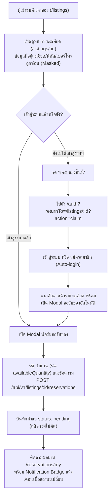
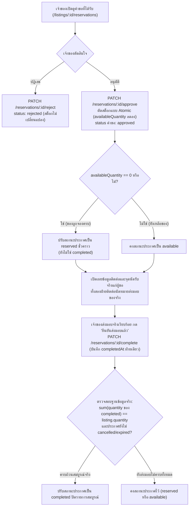
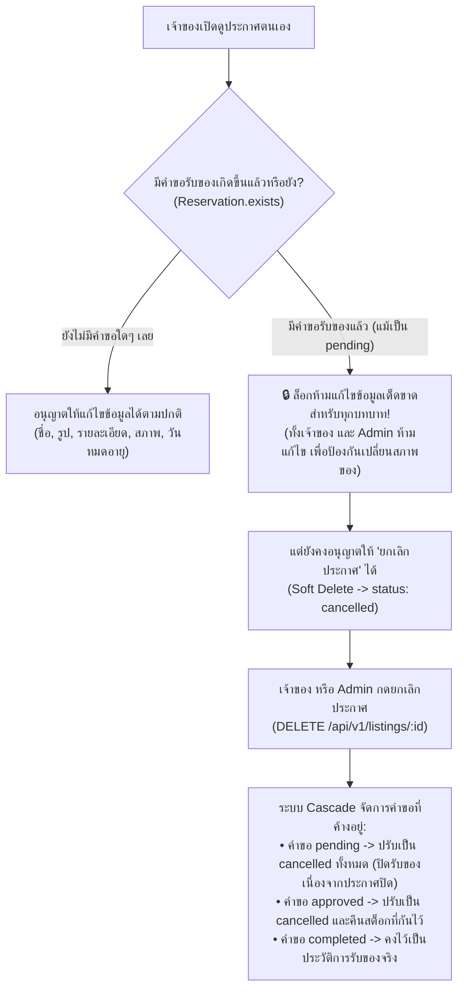

# แผนพัฒนา Sharing Leftovers ให้เป็น Web Application ด้วย EJS

จากสถาปัตยกรรมที่มีอยู่ ผมแนะนำให้พัฒนา Sharing Leftovers เป็นเว็บแอปพลิเคชันแบบ Multi-page SSR ที่มี Interactive UI ด้วย Vanilla JavaScript โดยใช้ Express + EJS เป็นแกนหลัก และคง RESTful API เดิมไว้สำหรับการรับส่งข้อมูลแบบ JSON

แนวทางนี้เหมาะกับโปรเจกต์ปัจจุบัน เพราะมีทั้งระบบสมาชิก การค้นหาสิ่งของใกล้ตัว การขอรับและส่งมอบสิ่งของ ตลอดจนหน้า Admin และมี Backend ที่ออกแบบไว้แล้วค่อนข้างครบ จึงไม่จำเป็นต้องเปลี่ยนไปใช้ React หรือสร้าง Backend ใหม่ทั้งหมด

## 1. ภาพรวมสถาปัตยกรรมที่แนะนำ

Presentation Layer — EJS + CSS + Vanilla JS

หน้าเว็บ รายการสิ่งของ ฟอร์ม Modal แผงควบคุม และ Responsive UI

HTTP Request / Response

Express Application

Web Routes · API Routes · Authentication · Authorization · Validation · Error Handling

เรียกใช้ Business Logic ชุดเดียวกัน

Service Layer

Auth · Users · Categories · Listings · Reservations · Reports

Mongoose Models → MongoDB

Users · Categories · Listings · Reservations · Reports · Sessions

หลักสำคัญคือแยกความรับผิดชอบของแต่ละส่วนให้ชัดเจน

- Web Routes และ Web Controllers ใช้แสดงหน้า EJS และจัดการการส่งฟอร์มที่ต้องเปลี่ยนหน้า
- API Routes และ API Controllers ใช้ตอบกลับ JSON ตาม REST API ที่มีอยู่
- Service Layer เป็นที่รวมกฎทางธุรกิจ เช่น การสร้างประกาศ การอนุมัติคำขอ และการคืนจำนวนสิ่งของ
- Vanilla JavaScript ใช้เพิ่มความโต้ตอบ เช่น ค้นหาแบบไม่โหลดหน้าใหม่ เปิด Modal เปลี่ยนตัวกรอง และอัปเดตสถานะรายการ

Express รองรับการกำหนด View Engine เพื่อแปลงเทมเพลตเป็น HTML ที่ส่งไปยังเบราว์เซอร์โดยตรงอยู่แล้ว จึงไม่จำเป็นต้องเพิ่ม Frontend Framework เพื่อให้ได้หน้าเว็บที่ใช้งานได้จริง&#x20;

[image](https://www.google.com/s2/favicons?domain=https://expressjs.com\&sz=32)

Express.js 5.x


### ทำไมจึงแนะนำ SSR แบบผสมกับ JavaScript?

สมมติผู้ใช้เปิดหน้า `/listings` ระบบสามารถค้นหาข้อมูลจาก MongoDB แล้วส่ง HTML ที่มีรายการสิ่งของมาให้เบราว์เซอร์ทันที ส่วนช่องค้นหาและตัวกรองอาจใช้ GET Request หรือ JavaScript เรียก API เพิ่มเติมได้ตามความเหมาะสม

วิธีนี้ดีกว่าการรวมทุกอย่างไว้ใน `home.ejs` ไฟล์เดียว และไม่จำเป็นต้องให้หน้าเว็บทุกส่วนเรียก API ของเซิร์ฟเวอร์ตัวเองผ่าน HTTP ทั้งหมด เพราะ Web Controller สามารถเรียกใช้ Service โดยตรงได้

ข้อเสนอหลัก: คง REST API เดิมไว้ แต่เพิ่ม Web Presentation Layer และค่อย ๆ แยก Business Logic ออกจาก Controller เท่าที่จำเป็น โดยไม่ต้องรื้อระบบในครั้งเดียว

## 2. กำหนดโครงสร้างหน้าเว็บทั้งหมดก่อนลงมือเขียนโค้ด

ผมแนะนำให้แบ่งเว็บเป็น 3 ส่วนตามบทบาท ได้แก่ Public, Member และ Admin โดยแต่ละส่วนใช้ Design System และ Component ร่วมกัน เพื่อไม่ต้องออกแบบหน้าเว็บแยกกันอย่างกระจัดกระจาย

### 2.1 Public — ผู้เข้าชมทั่วไป

ผู้เข้าชมควรค้นหาและดูรายละเอียดสิ่งของได้โดยไม่ต้องสมัครสมาชิกก่อน เพราะเป้าหมายหลักของแพลตฟอร์มคือทำให้การแบ่งปันสิ่งของเข้าถึงได้ง่าย

[DonBurkina - Marketplace solidaire pour · Built with Blink](https://images.openai.com/static-rsc-4/JaU_xaqntvFIKRsIY6tOGISMEzBRb1rk0mIbgAfI8001s_DC8QoRjXOWImL8NRvMeBliMBedyR12vQthe8lNG3u_pgLPdOgBuGHN7w8lGruiVneuIicdGdtZBPRgEp4PShZxJ1ZW1s7TOjk97XK3bXM1oXP8nTP6EVPOFt294kw?purpose=inline)

หน้าแรก — `/`

เป้าหมาย: ให้ผู้ใช้เริ่มค้นหาสิ่งของได้ทันที

มี Hero Section พร้อมช่องค้นหา หมวดหมู่ยอดนิยม รายการสิ่งของล่าสุด วิธีการแบ่งปัน และปุ่มลงประกาศหรือค้นหาของใกล้ตัว

[Télécharger Geev pour Web, iOS, Android - Telecharger.com](https://images.openai.com/static-rsc-4/uDcyBtN-hMGt0f-sp_c1S-4r5bN17xtUICbSRoBwRB2ZmTFcnavjt_7ClSLTmEr_HC94QhlnbYBXzwH7WjAgVdit7O0cMzqD8pHyRW0oHQBvFh0nWZWyv4UuGa_qiv-HsT81M9T4vmYOEjoAao0sQRNWaOVn9LMJ_B-WtgMMKH4?purpose=inline)

[Télécharger Geev pour Web, iOS, Android - Telecharger.com](https://images.openai.com/static-rsc-4/uDcyBtN-hMGt0f-sp_c1S-4r5bN17xtUICbSRoBwRB2ZmTFcnavjt_7ClSLTmEr_HC94QhlnbYBXzwH7WjAgVdit7O0cMzqD8pHyRW0oHQBvFh0nWZWyv4UuGa_qiv-HsT81M9T4vmYOEjoAao0sQRNWaOVn9LMJ_B-WtgMMKH4?purpose=inline)

หน้าค้นหาสิ่งของ — `/listings`

เป้าหมาย: ช่วยให้เจอของที่ต้องการได้เร็ว

แสดงการ์ดสิ่งของพร้อมรูป ชื่อ สภาพ จำนวนที่เหลือ พื้นที่โดยประมาณ และตัวกรองหมวดหมู่ สภาพ ระยะทางรอบตัว (GPS Radius) พร้อม **ตัวกรองพื้นที่ด้วยตนเอง (จังหวัด, อำเภอ, ตำบล)** กรณีผู้ใช้ไม่อนุญาต GPS และการเรียงลำดับ (มาใหม่, ยอดนิยม, ใกล้หมดเวลา) พร้อม Pagination

[ハイジ・インターフェイス株式会社 | HYGE Interface Inc.](https://images.openai.com/static-rsc-4/-zOBGsoBFlri2xI2PzVdVHNaIWKE71EqXSs7ULDHnpD9ijadRbvcMMdkKsCFXP03vXzPVGnnt6txBh12YC0dUhz1Ew6rCtbuSnr-kxjN5iN17CNOYdjWdtJGv5pc_LlQdbC87LJGri95ft9IPlH-eDMXKihYLgU5fQ9fs1FcSPQ?purpose=inline)

หน้ารายละเอียดสิ่งของ — `/listings/:id`

เป้าหมาย: ช่วยตัดสินใจขอรับสิ่งของ (ยึดหลัก Privacy by Design)

รูปภาพ รายละเอียด สภาพ จำนวนที่เหลือ ข้อมูลเจ้าของ วิธีรับของ (`pickup` นัดรับเท่านั้น) ช่วงเวลานัดรับ และปุ่มขอรับสิ่งของ รวมถึงปุ่มรายงานประกาศเมื่อเข้าสู่ระบบ
* **ความเป็นส่วนตัว (Privacy by Design):** Guest และบุคคลทั่วไปดูรายละเอียดประกาศได้ครบถ้วน แต่ **ที่อยู่นัดรับแบบละเอียด พิกัดแม่นยำ (lat/lng) และเบอร์โทรศัพท์ของเจ้าของจะถูกซ่อนไว้ (Masked)** โดยจะเปิดเผยให้เฉพาะผู้ขอที่ได้รับการอนุมัติคำขอแล้วเท่านั้น

[EcoConnect | Devpost](https://images.openai.com/static-rsc-4/DzK7DX7kMOnhY6lXe-vLibS565PQR3-iRukOTLM2c3AwcMGaupcI8KCLRTkVzcnPM-GODeIEdOwodti9ho-_wCS5B4u9ulBsVVdkmbnQs698CYu6q89fIOz2L5UlW8nu6vMQztxJhWiRRiM3pFVtr_gsojwN1Qoda6o4BBmrSIM?purpose=inline)

หน้าเข้าสู่ระบบและสมัครสมาชิก — รวมหน้าเดียว `/auth`

รวม Login และ Register อยู่ในหน้าเดียวกัน สลับแท็บได้ สมัครสมาชิกเสร็จระบบจะ Auto-login ทันที พร้อมกลไกส่งต่อ URL ปลายทางที่ปลอดภัย (`returnTo=/listings/:id?action=claim`) เมื่อเข้าสู่ระบบสำเร็จจะพากลับมาเปิด Modal ฟอร์มขอรับของให้อัตโนมัติ

หน้าเพิ่มเติมที่ควรมี ได้แก่ `/help/how-it-works` สำหรับอธิบายขั้นตอนการแบ่งปัน และหน้า Error สำหรับกรณี 404 หรือเซิร์ฟเวอร์ขัดข้อง

### 2.2 Member — สมาชิกที่เข้าสู่ระบบ

สมาชิกเป็นผู้ใช้งานหลักของระบบ ออกแบบให้จัดการสิ่งของทั้งในบทบาทผู้แบ่งปันและผู้ขอรับได้จากพื้นที่ศูนย์กลางเดียวกัน

| หน้าเว็บ | ความสามารถที่ต้องมี | Endpoint อ้างอิง |
| :--- | :--- | :--- |
| `/dashboard` | แดชบอร์ดศูนย์กลาง สลับดู 2 แท็บ: ประกาศของฉัน และ คำขอของฉัน พร้อม Notification Badge | `GET /dashboard` |
| `/listings/new` | สร้างประกาศใหม่ (บังคับรูป 1–5 รูป, รายละเอียด, สภาพ, นัดรับเท่านั้น `pickup`) | `GET, POST /listings/new` |
| `/listings/:id/edit` | แก้ไขประกาศ (ล็อกห้ามแก้เด็ดขาดหากมีคำขอรับของแล้วทุกกรณี) | `GET, POST /listings/:id/edit` |
| `/users/me/listings` | จัดการประกาศทั้งหมดของตนเอง ตรวจสอบสต็อก และเปิดดูคำขอที่ได้รับ | `GET /api/v1/users/me/listings` |
| `/reservations/my` | ดูคำขอรับสิ่งของที่ตนส่งไป (สถานะ pending, approved, completed พร้อม Unread Badge) | `GET /api/v1/reservations/my` |
| `/listings/:id/reservations` | ดูและจัดการคำขอที่ผู้อื่นส่งมายังประกาศของตน (ปุ่ม Approve, Reject, Complete) | `GET /api/v1/listings/:id/reservations` |
| `/users/me` | โปรไฟล์ของฉัน (ดูและแก้ไขชื่อ, เบอร์โทรศัพท์, ที่อยู่ประจำตัว) | `GET, PATCH /api/v1/users/me` |
| `/auth/password` | เปลี่ยนรหัสผ่าน (กรอกรหัสผ่านเดิมและรหัสผ่านใหม่) | `PATCH /api/v1/auth/password` |

สิ่งสำคัญ: ไม่แยก Dashboard เป็นสองระบบใหญ่ ให้สมาชิกคนเดียวทำได้ทั้งสองบทบาทในหน้า `/dashboard` โดยมีแท็บสลับระหว่าง "คำขอของฉัน" และ "ประกาศของฉัน" อย่างลื่นไหล

### 2.3 Admin — ผู้ดูแลระบบ

วางหน้า Admin แยกเป็น Back-Office Management อย่างชัดเจน (`/admin/*`) โดยไม่ปะปนกับหน้าบ้านสาธารณะ และยึดหลัก **Admin Permission Isolation**: Admin ดูแลระบบหลังบ้านเท่านั้น ไม่สามารถแก้ไขข้อมูลประกาศของผู้อื่นได้ (โยน 403 Forbidden) แต่มีอำนาจสั่งยกเลิกประกาศผิดกฎได้โดยตรง

| หน้าเว็บ | ความสามารถที่ต้องมี | Endpoint อ้างอิง |
| :--- | :--- | :--- |
| `/admin` | ภาพรวมระบบ จำนวนผู้ใช้ ประกาศ และรายงานที่รอจัดการ | `GET /admin` |
| `/admin/listings` | ตารางจัดการและค้นหาประกาศสิ่งของ กลั่นกรองและยกเลิกประกาศผิดกฎโดยตรง (Soft Delete $\rightarrow$ `cancelled` พร้อม Cascade Cancel คำขอที่ค้างอยู่) | `GET /admin/listings`<br>`DELETE /api/v1/listings/:id` |
| `/admin/users` | จัดการสมาชิก ค้นหา ดู และระงับ/ปลดระงับบัญชีผู้ใช้ (`isActive: false` พร้อมตัด Session ออกทันที, ห้ามแก้ไขฟิลด์ `role` เด็ดขาดเพื่อความปลอดภัย) | `GET /admin/users`<br>`PATCH /api/v1/users/:id/status` |
| `/admin/categories` | จัดการหมวดหมู่สิ่งของ เพิ่ม แก้ไข เปิด/ปิด และ Soft-delete (ห้ามลบจริงถ้ามีประกาศผูกอยู่) | `GET /admin/categories`<br>`/api/v1/categories` |
| `/admin/reports` | ตรวจสอบรายงานปัญหา กรองตามสถานะและประเภทปัญหา (spam, fraud, illegal ฯลฯ) | `GET /admin/reports`<br>`/api/v1/reports` |
| `/admin/reports/:id` | ตรวจสอบรายละเอียดรายงานและอัปเดตสถานะ (`reviewing`, `resolved`, `rejected`) | `PATCH /api/v1/reports/:id` |

## 3. ออกแบบหน้าจอและ User Flow ที่สำคัญ

ก่อนทำ CSS ควรกำหนดโครงสร้างของแต่ละหน้าว่าต้องแสดงอะไร ผู้ใช้กดอะไรได้ และระบบตอบกลับอย่างไร

### 3.1 หน้าแรกและหน้าค้นหา

โครงสร้างหน้าแรกที่แนะนำคือ

### Sharing Leftovers

ส่วนหัวที่ใช้ร่วมกันทุกหน้าหลัก

# แบ่งปันสิ่งของ ส่งต่อคุณค่าให้ชุมชน

ค้นหาของที่ต้องการ หรือส่งต่อสิ่งของที่คุณไม่ได้ใช้แล้ว

คุณกำลังมองหาสิ่งของอะไร?

ค้นหาสิ่งของใกล้คุณ

เลือกตามหมวดหมู่

อาหาร

เสื้อผ้า

ของใช้

### สิ่งของที่เพิ่งแบ่งปัน

[A part of Barnebys Group](https://images.openai.com/static-rsc-4/CTR-_fCZvBVmpBhtP5sz62wvwX48Yta4AtKJQxhl05972u_3VzbEPKoRogBA0Wy5e2CHCrQD5IOiokxmTtQ3O2nAyE-S6avUr-r7jnlF2wUEAC_EcUuasEZ7uB1jQXzTInESwefUuK8z9fI7U4i-RGOJoo7JOMJwVWvCDaoPXq0?purpose=inline)

โต๊ะทำงานสภาพดี

หมวดหมู่: เฟอร์นิเจอร์

พร้อมรับ · พื้นที่โดยประมาณ

ตัวอย่าง Wireframe เท่านั้น — ยังไม่ใช่ข้อมูลจริงของระบบ

หน้าแรกไม่ควรเป็นเพียง Dashboard ของทุกบทบาทที่ซ่อนและแสดงด้วย Modal แต่ควรทำหน้าที่เป็นประตูเข้าสู่การค้นหาและแบ่งปัน ส่วน Dashboard สมาชิกและ Admin ควรเป็นหน้าที่มี URL ของตัวเอง

### 3.2 Flow การขอรับและส่งมอบสิ่งของ (End-to-End Core Workflow)

#### 3.2.1 ฝั่งผู้ขอรับสิ่งของ (Requester Flow)


#### 3.2.2 ฝั่งเจ้าของประกาศ (Owner Management Flow)


ทุกสถานะต้องมีข้อความที่ผู้ใช้เข้าใจได้ ไม่ใช่แสดงเพียงค่าจากฐานข้อมูล

| สถานะ | สิ่งที่ผู้ใช้ควรเห็น | ความหมายและการทำงาน |
| :--- | :--- | :--- |
| `pending` | รอเจ้าของพิจารณาคำขอ | คำขอถูกส่งแล้ว รอเจ้าของตัดสินใจ (สต็อกยังไม่ถูกตัด) |
| `approved` | ได้รับอนุมัติแล้ว ดูวิธีนัดรับ | เจ้าของอนุมัติตัดสต็อกแล้ว เปิดเผยจุดนัดรับ/ข้อมูลติดต่อจริง |
| `rejected` | คำขอไม่ได้รับอนุมัติ | เจ้าของปฏิเสธคำขอ (สต็อกไม่เปลี่ยนแปลง) |
| `cancelled` | ยกเลิกคำขอแล้ว | ผู้ขอหรือเจ้าของยกเลิกนัดหมายหลังอนุมัติ (ระบบคืนสต็อก 1 ครั้ง) |
| `completed` | ส่งมอบสิ่งของเรียบร้อยแล้ว | เจ้าของกดยืนยันส่งมอบสำเร็จ บันทึก `completedAt` ปิดงาน |

### 3.3 Flow การลงประกาศสร้างสิ่งของ (`/listings/new`)

หน้า `/listings/new` บังคับ Validation Rules ที่เข้มงวดเพื่อความโปร่งใสและคุณภาพของข้อมูลในชุมชน:

1. **ฟิลด์บังคับ (Required Fields):**
   * **ชื่อสิ่งของ (`title`):** ข้อความระบุชื่อสิ่งของชัดเจน
   * **หมวดหมู่ (`category`):** อ้างอิง Category ที่มีอยู่จริงในระบบ
   * **สภาพสิ่งของ (`condition`):** เลือกจาก `new`, `like_new`, `good`, `fair`, `poor`
   * **จำนวนสิ่งของ (`quantity`):** จำนวนเต็ม $\ge 1$
   * **รายละเอียดสิ่งของ (`description`):** บังคับกรอก เพื่อความชัดเจนและโปร่งใส
   * **วิธีรับของ (`pickup.method`):** กำหนดเป็น **นัดรับด้วยตนเองเท่านั้น (`"pickup"`)** (ไม่มีตัวเลือกจัดส่งพัสดุ เพื่อความปลอดภัย ความโปร่งใส และการสร้างปฏิสัมพันธ์ที่ดีในชุมชน) บังคับระบุพื้นที่รับของ (`pickup.address` / ตำบล อำเภอ จังหวัด) โดยข้อมูลละเอียดจะถูก Masked และเปิดเผยเฉพาะผู้ขอที่ได้รับอนุมัติแล้วเท่านั้น
2. **รูปภาพสิ่งของ (`images`):**
   * บังคับอัปโหลดอย่างน้อย 1 รูป (`min: 1`) และสูงสุดไม่เกิน 5 รูป (`max: 5`)
3. **วันหมดอายุประกาศ (`expiresAt`):** ต้องระบุวันที่ในอนาคตที่สมเหตุสมผล

### 3.4 Flow การแก้ไขและยกเลิกประกาศ (Strict Edit Lock & Cascade Cancellation)



## 4. ออกแบบโครงสร้างไฟล์ Frontend และ Backend

นี่คือโครงสร้างที่ผมแนะนำให้ต่อยอดจากโปรเจกต์เดิม โดยไม่ย้ายไฟล์ทั้งหมดพร้อมกัน

```

Sharing-Leftovers/
├── .env.example
├── package.json
├── server.js
│
├── frontend/
│   ├── public/
│   │   ├── css/
│   │   │   ├── tokens.css
│   │   │   ├── layout.css
│   │   │   ├── components.css
│   │   │   └── pages.css
│   │   ├── js/
│   │   │   ├── app.js
│   │   │   ├── search.js
│   │   │   ├── modal.js
│   │   │   └── form-validation.js
│   │   └── images/
│   │
│   └── views/
│       ├── partials/
│       │   ├── head.ejs
│       │   ├── header.ejs
│       │   ├── footer.ejs
│       │   ├── flash.ejs
│       │   ├── listing-card.ejs
│       │   ├── pagination.ejs
│       │   └── empty-state.ejs
│       │
│       ├── pages/
│       │   ├── home.ejs
│       │   ├── listings/
│       │   │   ├── index.ejs
│       │   │   ├── show.ejs
│       │   │   ├── new.ejs
│       │   │   └── edit.ejs
│       │   ├── auth/
│       │   │   ├── login.ejs
│       │   │   └── register.ejs
│       │   ├── dashboard/
│       │   │   ├── index.ejs
│       │   │   ├── my-listings.ejs
│       │   │   ├── my-requests.ejs
│       │   │   └── received-requests.ejs
│       │   ├── profile/
│       │   │   ├── edit.ejs
│       │   │   └── security.ejs
│       │   └── admin/
│       │       ├── index.ejs
│       │       ├── users.ejs
│       │       ├── categories.ejs
│       │       └── reports.ejs
│       │
│       └── errors/
│           ├── 404.ejs
│           └── 500.ejs
│
└── src/
    ├── app.js
    ├── seed.js
    ├── config/
    │   ├── database.js
    │   └── swagger.js
    ├── models/
    ├── routes/
    │   ├── web.routes.js
    │   ├── auth.routes.js
    │   ├── user.routes.js
    │   ├── category.routes.js
    │   ├── listing.routes.js
    │   ├── reservation.routes.js
    │   └── report.routes.js
    ├── controllers/
    │   ├── web/
    │   │   ├── home.controller.js
    │   │   ├── listing-page.controller.js
    │   │   ├── auth-page.controller.js
    │   │   ├── dashboard.controller.js
    │   │   └── admin-page.controller.js
    │   ├── auth.controller.js
    │   ├── user.controller.js
    │   ├── category.controller.js
    │   ├── listing.controller.js
    │   ├── reservation.controller.js
    │   └── report.controller.js
    ├── services/
    │   ├── auth.service.js
    │   ├── user.service.js
    │   ├── category.service.js
    │   ├── listing.service.js
    │   ├── reservation.service.js
    │   └── report.service.js
    └── middlewares/
        ├── auth.js
        ├── errorHandler.js
        ├── csrf.js
        └── attachLocals.js

```

โครงสร้างนี้เป็นเป้าหมายเมื่อระบบเริ่มขยาย ไม่จำเป็นต้องสร้างไฟล์ทุกไฟล์ในวันแรก

### หน้าที่ของไฟล์สำคัญ

| ส่วน                          | หน้าที่                                                         |
| ----------------------------- | --------------------------------------------------------------- |
| `views/pages/`                | HTML ของแต่ละหน้า                                               |
| `views/partials/`             | ชิ้นส่วน UI ที่นำกลับมาใช้ซ้ำ                                   |
| `web.routes.js`               | URL ของหน้าเว็บและฟอร์มแบบ SSR                                  |
| `controllers/web/`            | เตรียมข้อมูลและสั่ง `res.render()` หรือ Redirect                |
| `controllers/*.controller.js` | รับคำขอ API และส่ง JSON                                         |
| `services/`                   | กฎทางธุรกิจที่ทั้ง Web และ API ใช้ร่วมกัน                       |
| `middlewares/attachLocals.js` | เตรียมข้อมูลผู้ใช้ ข้อความแจ้งเตือน และตัวแปรส่วนกลางสำหรับ EJS |
| `public/js/`                  | ฟังก์ชันโต้ตอบเฉพาะหน้า                                         |

### การตั้งค่า EJS

ใน `src/app.js` ให้กำหนดตำแหน่ง Template และ Static Files ให้ชัดเจน เช่น

```
const path = require('node:path');

app.set(
  'views',
  path.join(__dirname, '../frontend/views')
);

app.set('view engine', 'ejs');

app.use(
  express.static(
    path.join(__dirname, '../frontend/public')
  )
);
```

สมมติ `src/app.js` อยู่ในตำแหน่งตามโครงสร้างที่ระบุข้างต้น โค้ดนี้จะชี้ไปยังโฟลเดอร์ `frontend/views` และ `frontend/public` ได้โดยไม่ขึ้นกับโฟลเดอร์ที่ใช้รันคำสั่ง Node.js

จากนั้นสร้างหน้าแรกด้วย Controller เช่น

```
function renderHome(req, res) {
  res.render('pages/home', {
    pageTitle: 'Sharing Leftovers'
  });
}
```

และผูกกับ `GET /` ใน Web Router โดยต้องตรวจสอบและปรับเส้นทางเดิมที่มีอยู่แล้ว เพื่อไม่ให้มีการประกาศ `GET /` ซ้ำกัน

## 5. ออกแบบ Shared UI Components และ Design System

หากทุกหน้ามี Header, ปุ่ม, การ์ด และฟอร์มที่หน้าตาแตกต่างกันมาก เว็บจะดูไม่เป็นระบบ ดังนั้นควรกำหนด Design System ก่อนเขียน CSS จำนวนมาก

### 5.1 Design Direction

แนะนำแนว Friendly Community Marketplace ใช้ความเป็นมิตรและน่าเชื่อถือ ไม่ทำให้เว็บดูคล้ายระบบหลังบ้านหรือ Dashboard สำหรับธุรกิจมากเกินไป

#### สีหลัก

Forest Green

\#246B4A

ปุ่มหลัก ลิงก์สำคัญ และการกระทำที่ต้องการเน้น

#### สีพื้นหลัง

Warm Neutral

\#F7F7F2

พื้นหลังหลักเพื่อให้รูปภาพสิ่งของดูโดดเด่น

#### พื้นผิว

White

\#FFFFFF

การ์ดสิ่งของ ฟอร์ม และส่วนเนื้อหา

#### สีแจ้งเตือน

Muted Terracotta

\#B85C38

ข้อผิดพลาด ยกเลิก หรือคำเตือนที่สำคัญ

สีข้างต้นเป็นข้อเสนอเริ่มต้น ควรตรวจสอบ Contrast Ratio ก่อนใช้งานจริง โดยเฉพาะตัวอักษรขนาดเล็กและปุ่มที่มีข้อความสีขาว

### 5.2 Components ที่ควรมี

เริ่มจาก Component ที่ใช้ซ้ำในหลายหน้า ได้แก่

Shared Layout: Header, Footer, Main Container, Navigation, Breadcrumbs

Listing Components: Listing Card, Category Badge, Condition Badge, Availability Badge, Image Gallery

Form Components: Input, Textarea, Select, Error Message, Help Text, Submit Button, Cancel Button

Interaction Components: Confirmation Dialog, Toast/Flash Message, Dropdown, Mobile Navigation

Data Components: Pagination, Empty State, Loading State, Error State

ตัวอย่าง `listing-card.ejs` ควรรับข้อมูลประกาศ 1 รายการ แล้วนำไปใช้ได้ทั้งหน้าแรก หน้าค้นหา และ Dashboard โดยไม่คัดลอก HTML การ์ดซ้ำสามชุด

```
<article class="listing-card">
  <a href="/listings/<%= listing._id %>"
     class="listing-card__link">

    "
      alt="<%= listing.title %>"
      loading="lazy"
    >

    <div class="listing-card__content">
      <h3><%= listing.title %></h3>
      <p><%= listing.description || 'ไม่มีรายละเอียดเพิ่มเติม' %></p>
    </div>
  </a>
</article>
```

ตัวอย่างนี้เป็นเพียงโครงเริ่มต้น ต้องตรวจสอบ URL ของรูปภาพและออกแบบการจัดการกรณีรูปโหลดไม่สำเร็จเพิ่มเติม

EJS มีทั้งแท็ก `<%=` ซึ่ง Escape ค่า HTML และ `<%-` ซึ่งส่งค่าออกมาโดยไม่ Escape สำหรับ include ของ Template ควรใช้ `<%- include(...) %>` ตามรูปแบบเอกสาร EJS และใช้ `<%=` กับข้อความที่ผู้ใช้กรอกเป็นหลัก เพื่อช่วยลดความเสี่ยงจาก HTML Injection และ XSS ([EJS Documentation](https://ejs.co/docs/))&#x20;

[image](https://www.google.com/s2/favicons?domain=https://ejs.co\&sz=32)

EJS Docs


## 6. วางรูปแบบการทำงานระหว่าง Web, API และ Service

นี่คือส่วนสำคัญที่สุดในการทำให้โปรเจกต์ขยายได้โดยไม่สร้างโค้ดซ้ำซ้อน

### 6.1 แยก Controller ออกจาก Business Logic

จากโครงสร้างปัจจุบัน Controller อาจมีทั้งการตรวจสอบสิทธิ์ การตรวจจำนวนสิ่งของ การเปลี่ยนสถานะ และการบันทึก MongoDB อยู่รวมกัน

เมื่อเพิ่ม EJS อย่านำ Logic เหล่านั้นไปเขียนซ้ำใน Web Controller

ควรเปลี่ยนให้เป็นลักษณะนี้

กรณีอนุมัติคำขอรับสิ่งของ

API Controller

อ่าน Reservation ID จาก URL เรียก Service และส่ง JSON กลับ

Web Controller

อ่าน Reservation ID จากฟอร์ม เรียก Service แล้ว Redirect กลับหน้า Dashboard

reservation.service.js

ตรวจสถานะคำขอ สิทธิ์เจ้าของ ตรวจจำนวนที่เหลือ ใช้ Atomic Operation และบันทึกผลลัพธ์

แนวทางนี้ทำให้การอนุมัติคำขอผ่าน API หรือการกดปุ่มในเว็บใช้กฎธุรกิจเดียวกัน

### 6.2 ตัวอย่างการเพิ่ม Web Routes

```
router.get('/', homeController.index);

router.get('/listings', listingPageController.index);
router.get('/listings/new',
  requireAuth,
  listingPageController.newForm
);
router.post('/listings',
  requireAuth,
  listingPageController.create
);
router.get('/listings/:id',
  listingPageController.show
);

router.get('/login', authPageController.loginForm);
router.post('/login', authPageController.login);
router.get('/register', authPageController.registerForm);
router.post('/register', authPageController.register);

router.get('/dashboard',
  requireAuth,
  dashboardController.index
);

router.get('/admin',
  requireAuth,
  requireAdmin,
  adminPageController.index
);
```

โค้ดนี้แสดงแนวทางการจัด Route เท่านั้น ยังต้องเพิ่ม Routes สำหรับฟอร์มแก้ไขประกาศ การจัดการคำขอ โปรไฟล์ และรายงาน รวมถึง CSRF middleware และการจัดการข้อผิดพลาดให้ครบถ้วน

### 6.3 แยกวิธีตอบกลับตามช่องทาง

| การกระทำ         | ช่องทาง Web SSR                | ช่องทาง REST API             |
| ---------------- | ------------------------------ | ---------------------------- |
| เปิดหน้ารายการ   | `res.render()`                 | ส่ง JSON                     |
| ค้นหาหรือกรอง    | GET Query + Render HTML        | `GET /api/v1/listings`       |
| สมัครสมาชิก      | รับ POST แล้ว Redirect         | `POST /api/v1/auth/register` |
| สร้างประกาศ      | POST แล้ว Redirect             | `POST /api/v1/listings`      |
| อนุมัติคำขอ      | POST แล้ว Redirect             | PATCH Endpoint ที่มีอยู่     |
| จัดการข้อผิดพลาด | แสดง Error Page/ข้อความในฟอร์ม | JSON Error ตาม Status Code   |

ควรกำหนดรูปแบบการตอบกลับให้สม่ำเสมอ เช่น API ใช้ `401` สำหรับไม่ได้เข้าสู่ระบบ, `403` สำหรับไม่มีสิทธิ์ และ `404` สำหรับไม่พบข้อมูลที่ร้องขอ ไม่ควรใช้การ Redirect ไปหน้า Login กับทุก API Request เพราะ Frontend ที่รอ JSON จะจัดการได้ยาก

## 7. จัดการ Authentication และ Session สำหรับหน้า EJS

ระบบมี Session-based authentication อยู่แล้ว จึงสามารถนำมาใช้กับ Web Routes ได้ ไม่จำเป็นต้องเพิ่ม JWT เพียงเพราะเปลี่ยนจาก API-only มาเป็นเว็บแอปพลิเคชัน

สิ่งที่ต้องเพิ่มคือการทำให้ทุกหน้ารับรู้สถานะผู้ใช้ได้สะดวก

### 7.1 ใช้ `res.locals` สำหรับข้อมูลส่วนกลาง

Middleware `attachLocals.js` ควรเตรียมตัวแปรที่ Template ต้องใช้เป็นประจำ เช่น

- `currentUser` — ผู้ใช้ที่เข้าสู่ระบบ โดยส่งเฉพาะข้อมูลที่จำเป็น
- `isAuthenticated` — สถานะการเข้าสู่ระบบ
- `flash` — ข้อความสำเร็จหรือข้อผิดพลาด
- `csrfToken` — Token สำหรับป้องกันคำขอปลอม หากใช้รูปแบบ Synchronizer Token

ไม่ควรส่ง `passwordHash` ไปยัง EJS แม้จะไม่ได้แสดงบนหน้าจอก็ตาม และไม่ควรให้ Template เป็นผู้ตัดสินใจสิทธิ์ทางธุรกิจแทน Middleware หรือ Service

### 7.2 หลักการออกแบบฟอร์ม

ฟอร์ม Login ควรมี Email, Password, ข้อความแจ้งเตือน และลิงก์สมัครสมาชิก หลัง Login สำเร็จให้กลับไปยังหน้าที่ผู้ใช้ต้องการ แต่ URL ปลายทางต้องผ่านการตรวจสอบเพื่อป้องกัน Open Redirect

สำหรับฟอร์มทุกชนิดที่เปลี่ยนข้อมูล เช่น POST, PATCH หรือ DELETE ต้องมีมาตรการ CSRF ที่เหมาะสม เพราะเบราว์เซอร์สามารถส่ง Session Cookie ไปกับคำขอได้โดยอัตโนมัติ OWASP แนะนำ Synchronizer Token Pattern สำหรับแอปพลิเคชันแบบ Stateful และระบุว่า SameSite Cookie เป็นเพียงการป้องกันเสริม ไม่ใช่สิ่งทดแทน CSRF Token&#x20;

[image](https://www.google.com/s2/favicons?domain=https://cheatsheetseries.owasp.org\&sz=32)

OWASP Cheat Sheet Series

+1


นอกจากนี้ควรตรวจสอบการตั้งค่า Cookie ให้ใช้ `HttpOnly`, `Secure` ใน Production และ `SameSite` ที่เหมาะสมกับรูปแบบการใช้งาน

### 7.3 การรักษาความต่อเนื่องของ UX

ตัวอย่างเมื่อสมาชิกกดอนุมัติคำขอแล้วเกิดข้อผิดพลาด:

- หากสินค้าไม่เหลือเพียงพอ ให้แจ้งเหตุผลและอัปเดตจำนวนล่าสุด
- หากคำขอถูกจัดการโดยอีกคนไปแล้ว ให้แสดงสถานะล่าสุดแทนการแจ้ง Error กว้าง ๆ
- หาก Session หมดอายุ ให้กลับเข้าสู่ระบบและพากลับมายังหน้าที่เกี่ยวข้องได้เมื่อปลอดภัย
- หาก Validation ไม่ผ่าน ให้แสดงข้อความใต้ช่องที่ผิด และรักษาค่าที่กรอกไว้

หลักการคือ ระบบต้องอธิบายสิ่งที่เกิดขึ้น และบอกผู้ใช้ว่าควรทำอะไรต่อ

## 8. แผนพัฒนาแบบเป็น Phase

ผมแนะนำให้ทำเป็น 7 Phase โดยมีผลลัพธ์และเงื่อนไขจบงานในแต่ละช่วง เพื่อป้องกันการใช้เวลาไปกับการตกแต่ง UI ก่อนที่ Flow หลักจะทำงานครบ

## 01

Phase 1 — ตรวจสอบระบบเดิมและเตรียม SSR

Foundation

ตรวจสอบ Express App, Route ที่มีอยู่, Session Middleware, Error Handler และไฟล์ `home.ejs` เดิม เพิ่มการตั้งค่า EJS, Static Files, Web Routes, Shared Header/Footer และหน้า 404/500

เงื่อนไขจบ: เว็บเปิดได้ทุกเส้นทางที่กำหนด หน้า API เดิมยังทำงาน และหน้า EJS รับข้อมูลจาก Controller ได้

## 02

Phase 2 — สร้างหน้าสาธารณะ

Public UI

ทำหน้าแรก หน้ารายการ หน้ารายละเอียด การ์ดสิ่งของ ระบบค้นหา ตัวกรอง หมวดหมู่ Pagination และ Empty State

เงื่อนไขจบ: ผู้เข้าชมสามารถค้นหา กรอง เปิดดูรายละเอียด และย้อนกลับไปยังผลการค้นหาโดยไม่ต้องเข้าสู่ระบบ

## 03

Phase 3 — ระบบบัญชีและโปรไฟล์

Authentication

ทำ Login, Register, Logout, หน้าโปรไฟล์ เปลี่ยนรหัสผ่าน, Flash Message, Validation และการป้องกัน CSRF

เงื่อนไขจบ: ผู้ใช้ทั่วไป สมาชิก และ Admin เห็นเมนูถูกต้อง และผู้ไม่มีสิทธิ์ไม่สามารถเข้าหน้าส่วนตัวได้ด้วยการพิมพ์ URL โดยตรง

## 04

Phase 4 — ระบบแบ่งปันและขอรับสิ่งของ

Core Workflow

ทำ Dashboard, สร้าง/แก้ไข/ยกเลิกประกาศ, ดูประกาศของตนเอง, ส่งคำขอรับของ, ดูคำขอขาเข้าและขาออก, อนุมัติ ปฏิเสธ ยกเลิก และยืนยันส่งมอบ

เงื่อนไขจบ: Flow ทำงานตั้งแต่ลงประกาศจนถึงส่งมอบจริงตามสถานะ และจำนวนสิ่งของไม่ติดลบหรือถูกอนุมัติเกินจำนวน

## 05

Phase 5 — ค้นหาเชิงพื้นที่และปรับ UX

เพิ่มตัวกรองระยะทาง การใช้พิกัดเมื่อผู้ใช้ยินยอม การค้นหาแบบ AJAX ตามความเหมาะสม รูปภาพหลายรูป และ UI สำหรับสถานะการโหลดหรือข้อผิดพลาด

เงื่อนไขจบ: ค้นหาด้วยระยะทางได้จริงเมื่อมีพิกัด รองรับกรณีปฏิเสธ Location Permission และยังใช้งานได้ด้วยการค้นหาตามพื้นที่ทั่วไป

## 06

Phase 6 — ระบบ Admin และ Report

ทำหน้า Dashboard ผู้ดูแล รายชื่อสมาชิก การจัดการหมวดหมู่ ตารางรายงาน ตัวกรองสถานะ และหน้าตรวจสอบรายงาน เพิ่ม API สำหรับส่วนที่ยังขาดตามความจำเป็น

เงื่อนไขจบ: Admin ดำเนินการจัดการบัญชี หมวดหมู่ และรายงานได้ โดยการเปลี่ยนสถานะทั้งหมดผ่านสิทธิ์ที่ตรวจสอบฝั่งเซิร์ฟเวอร์

## 07

Phase 7 — QA, Accessibility และ Production

ทดสอบ Responsive UI การเข้าสู่ระบบ ความปลอดภัยของ Session/CSRF, XSS, การเข้าถึงของผู้ใช้แต่ละบทบาท, Race Condition, การจัดการรูปเสีย และตรวจสอบค่าตั้งค่าก่อน Deploy

เงื่อนไขจบ: Flow หลักผ่าน Integration Test และการทดสอบด้วยเบราว์เซอร์ทั้ง Desktop และ Mobile โดยไม่มีปัญหาร้ายแรงที่ทราบอยู่

ลำดับนี้ตั้งใจให้ระบบมีประโยชน์จริงตั้งแต่ Phase 2–4 และค่อยเพิ่มความสามารถด้านแผนที่และลูกเล่นทีหลัง ไม่จำเป็นต้องทำ Animation หรือระบบ Real-time ก่อนให้ Flow การขอรับสิ่งของทำงานครบ

## 9. แผนเชื่อมแต่ละหน้าเข้ากับ API และข้อมูล

ก่อนเริ่มเขียน Frontend ให้กำหนดว่าหน้าไหนต้องใช้ข้อมูลอะไร และข้อมูลนั้นมาจาก Service ตัวไหน

| หน้า           | ข้อมูลที่ต้องใช้                         | แหล่งข้อมูล                   |
| -------------- | ---------------------------------------- | ----------------------------- |
| Home           | หมวดหมู่และประกาศล่าสุด                  | Category + Listing Service    |
| Listing Index  | รายการตาม Query, Pagination และระยะทาง   | Listing Service               |
| Listing Detail | ประกาศ เจ้าของ หมวดหมู่ และจำนวนที่เหลือ | Listing Service               |
| Dashboard      | ประกาศของตน คำขอขาเข้า/ขาออก             | Listing + Reservation Service |
| Profile        | ข้อมูลบัญชีปัจจุบัน                      | User Service                  |
| Admin Users    | รายชื่อและสถานะผู้ใช้                    | User Service                  |
| Admin Reports  | รายงานและสถานะการตรวจสอบ                 | Report Service                |

สำหรับหน้ารายการ ควรจัดการ Query String ให้สามารถแชร์ URL ที่กรองไว้ได้ เช่น

`/listings?category=books&condition=good&sort=latest&page=2`

ข้อดีคือผู้ใช้กด Refresh หรือ Back ได้ตามธรรมชาติ และ SSR สามารถ Render ผลลัพธ์ที่ตรงกับ URL ได้โดยตรง

### คำแนะนำเรื่องการเรียก API

สำหรับ Web Controller ที่อยู่ใน Express App เดียวกัน ให้เรียก Service โดยตรงแทนการใช้ `fetch('http://localhost:3000/api/v1/...')` จากฝั่งเซิร์ฟเวอร์ เพราะจะต้องจัดการ URL, Cookie และรูปแบบ Error ซ้ำโดยไม่จำเป็น

แต่สำหรับ JavaScript ในเบราว์เซอร์ ยังสามารถใช้ Fetch API เรียก REST API เดิมได้เมื่อจำเป็น เช่น โหลดรายการเพิ่มเติมหรือเปลี่ยนข้อมูลโดยไม่ต้อง Refresh

## 10. ประเด็น Backend ที่ควรตรวจสอบก่อนทำ UI

แม้โจทย์จะเป็นการพัฒนา Frontend แต่มีเงื่อนไขทางธุรกิจบางข้อที่ส่งผลต่อ UX โดยตรง

### 10.1 Reservation กับจำนวนสิ่งของ

ตาม Logic ที่ระบุไว้ ระบบตัด `availableQuantity` เมื่ออนุมัติ ไม่ใช่เมื่อส่งคำขอ ดังนั้นอาจมีผู้ใช้หลายคนส่งคำขอที่ยังเป็น `pending` พร้อมกันได้

UI ควรแยกให้เห็นความหมายของ “จำนวนที่ยังขอได้” กับ “จำนวนคำขอที่กำลังรอการพิจารณา” อย่างชัดเจน และต้องใช้จำนวนจากฐานข้อมูลที่ผ่านการตรวจสอบจริง ไม่คำนวณจำนวนคงเหลือจากตัวเลขบนหน้าจอเพียงอย่างเดียว

### 10.2 กฎเหล็ก: ผู้ใช้หนึ่งคนขอรับได้ครั้งเดียวต่อประกาศ (Single Lifetime Reservation)

ข้อตกลงที่ยืนยันแล้ว: ผู้ใช้ 1 คนสามารถสร้างคำขอรับสิ่งของได้เพียง 1 คำขอต่อ 1 ประกาศตลอดอายุของประกาศ แม้คำขอเดิมจะถูกปฏิเสธ (`rejected`) หรือยกเลิก (`cancelled`) ไปแล้วก็ตาม
* **ระดับฐานข้อมูล:** บังคับใช้ด้วย Unique Compound Index `{ listing: 1, requester: 1 }` บนโมเดล `Reservation` เพื่อป้องกันการสร้างคำขอซ้ำ แม้จะมีการกดย้ำพร้อมกัน (Concurrency Protection)
* **ระดับ UI/UX:** หน้ารายละเอียดประกาศ (`/listings/:id`) จะตรวจสอบว่าผู้ใช้ที่ล็อกอินอยู่มีประวัติคำขอในประกาศนี้หรือไม่ หากมีแล้วให้ Disable ปุ่มขอรับของ และแสดงข้อความแจ้งเตือนว่า *"คุณเคยส่งคำขอสำหรับสิ่งของชิ้นนี้ไปแล้ว"* พร้อมปุ่มลิงก์ไปยังหน้า `/reservations/my` เพื่อดูประวัติคำขอของตนเอง

### 10.3 สถานะ Listing และ Reservation

ควรกำหนดเงื่อนไขให้แน่นอน เช่น ประกาศเปลี่ยนเป็น `reserved` เมื่อไม่มีจำนวนเหลือให้ขอรับ และเมื่อมีการคืนจำนวนจากคำขอที่ถูกยกเลิกหรือปฏิเสธ สถานะต้องได้รับการปรับกลับตามเงื่อนไขที่กำหนด

ถ้าจำนวนเหลือเป็นศูนย์ชั่วคราวแต่ยังมีคำขอที่รอพิจารณา ต้องตัดสินใจว่าจะปิดการรับคำขอใหม่ทันทีหรือไม่ และ UI ต้องสื่อความหมายตรงกับ Behavior จริง

### 10.4 ความเป็นส่วนตัวของตำแหน่ง

การค้นหาด้วยพิกัดเป็นจุดเด่นของโปรเจกต์ แต่ไม่ควรแสดงพิกัดบ้านของสมาชิกหรือที่อยู่นัดรับแบบละเอียดต่อสาธารณะโดยไม่จำเป็น

แนะนำให้แสดงพื้นที่โดยประมาณในหน้าสาธารณะ และเปิดเผยรายละเอียดนัดรับแก่ผู้ที่มีสิทธิ์ เช่น เจ้าของและผู้ขอที่ได้รับอนุมัติ ตามกติกาที่ระบบกำหนด MongoDB รองรับการค้นหาเชิงพื้นที่ด้วย GeoJSON และ `2dsphere` อยู่แล้ว จึงสามารถเก็บความสามารถนี้ไว้ได้โดยไม่จำเป็นต้องเปลี่ยนฐานข้อมูล&#x20;

[image](https://www.google.com/s2/favicons?domain=https://www.mongodb.com\&sz=32)

MongoDB Docs

+1


## 11. JavaScript ควรทำอะไร และอะไรไม่ควรทำ

เพราะโปรเจกต์เลือก Vanilla JavaScript อยู่แล้ว ผมแนะนำให้ใช้ JavaScript เป็นตัวเสริม UX ไม่ใช่เป็นที่เก็บ Business Logic หลัก

เหมาะกับฝั่ง Frontend

- เปิด/ปิด Modal และเมนู
- ตรวจรูปแบบข้อมูลเบื้องต้นก่อนส่งฟอร์ม
- แสดง Preview รูปภาพก่อนบันทึก
- เปลี่ยนตัวกรองหรือโหลดรายการเพิ่มเติม
- ส่งคำขอผ่าน Fetch API เมื่ออยากลดการ Refresh
- ป้องกันการกดปุ่มซ้ำระหว่างกำลังส่งข้อมูล

ต้องอยู่ฝั่ง Backend เป็นหลัก

- ตรวจว่าเป็นเจ้าของประกาศหรือ Admin
- ตรวจจำนวนคงเหลือก่อนอนุมัติ
- เปลี่ยนสถานะ Reservation และ Listing
- ตรวจสิทธิ์รายงานและจัดการบัญชี
- ยืนยันความถูกต้องของพิกัด สถานะ และฟิลด์สำคัญ
- ตรวจ CSRF และ Session

ไม่ควรเชื่อค่าที่มาจาก DOM, Hidden Input หรือ JavaScript ว่าถูกต้องเพียงเพราะหน้าจอไม่แสดงปุ่มนั้นให้ผู้ใช้กด

## 12. แผนทดสอบที่ต้องมี

การทดสอบไม่ควรจบแค่หน้าเว็บแสดงผลถูกต้อง แต่ต้องตรวจทั้งสิทธิ์และสถานะทางธุรกิจด้วย

| หมวดทดสอบ      | กรณีที่ต้องครอบคลุม                                                         |
| -------------- | --------------------------------------------------------------------------- |
| Public Pages   | ค้นหาพบ/ไม่พบ แสดงรายละเอียดประกาศที่ยกเลิกแล้ว และ Pagination              |
| Authentication | สมัครสำเร็จ อีเมลซ้ำ รหัสผ่านไม่ถูกต้อง Logout และ Session หมดอายุ          |
| Listings       | สร้าง ยกเลิก, Strict Edit Lock เมื่อมีคำขอเกิดขึ้น (ล็อกห้ามแก้ทุกกรณี), และ Cascade Cancellation |
| Reservations   | ขอรับ อนุมัติ ปฏิเสธ ยกเลิก ส่งมอบ และการแย่งอนุมัติหลายรายการพร้อมกัน      |
| Authorization  | ผู้ใช้ทั่วไปเข้า `/admin` ไม่ได้ และผู้ใช้ที่ไม่ใช่เจ้าของแก้ไขประกาศไม่ได้ |
| Security       | CSRF Token ไม่ถูกต้อง ข้อมูลผู้ใช้แทรก HTML และการเข้าถึงที่อยู่ส่วนตัว     |
| Responsive     | Desktop, Tablet และ Mobile รวมถึงฟอร์มที่มีข้อความ Error ยาว                |

สำหรับการทดสอบ Frontend เริ่มจากการตรวจว่าหน้า Render ได้และฟอร์มส่งข้อมูลถูกต้อง จากนั้นค่อยเพิ่ม Integration Test สำหรับ Web Routes และ Service Layer ส่วน UI Automation เช่น Playwright ค่อยพิจารณาเพิ่มเมื่อ Flow หลักเริ่มคงที่แล้ว

## 13. แบ่งขอบเขต MVP กับสิ่งที่ควรทำภายหลัง

เพื่อไม่ให้โปรเจกต์ขยายจนทำเสร็จยาก ควรแบ่งความสำคัญดังนี้

## MVP — ต้องเสร็จก่อน (ขอบเขตงานเวอร์ชันเปิดตัว)

เป้าหมาย: สมาชิกแบ่งปันและขอรับสิ่งของได้ตั้งแต่ต้นจนจบ ปลอดภัย โปร่งใส และมีระบบกำกับดูแลหลังบ้านครบถ้วน

- [ ] หน้าแรกและค้นหาประกาศ (พร้อมตัวกรอง GPS Radius และตัวกรองพื้นที่แบบเลือกเอง จังหวัด/อำเภอ/ตำบล)
- [ ] หน้ารายละเอียดสิ่งของ (ยึดหลัก Privacy by Design: ซ่อนที่อยู่ละเอียด/พิกัด/เบอร์โทรจากสาธารณะ)
- [ ] หน้ารวมระบบยืนยันตัวตน (`/auth`: สลับ Login/Register ในหน้าเดียว, Auto-login, safe `returnTo`)
- [ ] สร้างประกาศ (`/listings/new` บังคับ URL รูปภาพ 1–5 รูป, รายละเอียด, สภาพ, นัดรับ Pickup เท่านั้น)
- [ ] นโยบายแก้ไขและยกเลิกประกาศ (Strict Edit Lock ห้ามแก้เมื่อมีคำขอแล้ว, Soft Delete `cancelled` + Cascade Cancel)
- [ ] ส่งคำขอและจัดการ Reservation ครบทุกสถานะ พร้อมตัดสต็อกแบบ Atomic
- [ ] ระบบส่งมอบแบบฝ่ายเดียว (`completedAt`) และปิดประกาศเมื่อยอดส่งมอบครบจริง ($\sum \text{qty} = \text{listing.qty}$)
- [ ] Dashboard สมาชิก (`/dashboard`), หน้าคำขอของฉัน (`/reservations/my` พร้อม Notification Badge), และหน้าโปรไฟล์/เปลี่ยนรหัสผ่าน
- [ ] ระบบหลังบ้าน Admin ครบ 4 ด้าน: จัดการหมวดหมู่, จัดการผู้ใช้ (ระงับบัญชี+ตัด Session), ตรวจสอบรายงานปัญหา, และตารางจัดการประกาศ (`/admin/listings`)
- [ ] Responsive UI, การจัดการข้อผิดพลาด (Flash Toast) และการป้องกันความปลอดภัย (CSRF / Input Sanitization)

## ระยะต่อไป — เมื่อ MVP เสถียรแล้ว

- [ ] แผนที่โต้ตอบแบบ Interactive Map (Leaflet / Google Maps API แสดงหมุดบนแผนที่)
- [ ] ค้นหาแบบ AJAX แบบ Instant Search (ไม่ต้องกดปุ่มค้นหา)
- [ ] ระบบแจ้งเตือนแบบ Real-time Push Notification (WebSocket / Web Push)
- [ ] ระบบอัปโหลดไฟล์รูปภาพจริง (File Upload ผ่าน Multer / Cloudinary / S3) แทนการกรอก URL
- [ ] ระบบแชทสนทนาโดยตรงระหว่างเจ้าของและผู้ขอรับของ
- [ ] การปรับปรุง SEO, Advanced Analytics และ Performance Monitoring

รายการด้านบนเป็น Checklist สำหรับใช้วางแผน ไม่ใช่สถานะความสำเร็จของโค้ดปัจจุบัน

## 14. สิ่งที่ควรลงมือทำเป็นลำดับแรก

จากโปรเจกต์ที่มีอยู่ ผมจะเริ่มต้นตามลำดับต่อไปนี้

1. ตรวจ `server.js`, `src/app.js`, `frontend/views/home.ejs`, `frontend/public/css/app.css` และ `frontend/public/js/app.js` เพื่อแยกส่วนที่ใช้ได้อยู่แล้วออกจากส่วนที่ควรปรับปรุง
2. สร้าง Web Routes และกำหนด EJS View Engine โดยคง API Routes เดิมไว้
3. แตก `home.ejs` ให้เหลือ Shared Partials และหน้าหลักที่เหมาะสม
4. ทำหน้า `/listings` และ `/listings/:id` ให้เสร็จก่อน เพราะเป็นแกนของแพลตฟอร์ม
5. เพิ่ม Login/Register และ Dashboard
6. เชื่อม Flow การขอรับสิ่งของให้ทำงานครบวงจร
7. ทำหน้า Admin และตรวจสอบระบบความปลอดภัย
8. จึงค่อยเพิ่ม UI แบบ AJAX แผนที่ และฟีเจอร์เสริม

ข้อสรุป: Sharing Leftovers ควรใช้ EJS เป็นตัว Render หน้าเว็บที่มี URL และแบ่งหน้าชัดเจน ใช้ Vanilla JavaScript เพิ่มความโต้ตอบ และให้ REST API ทำหน้าที่เป็นช่องทางรับส่ง JSON ที่ใช้งานร่วมกันได้ ส่วน Business Logic ควรรวมอยู่ใน Service Layer ไม่ว่าคำขอจะมาจาก Web Route หรือ API Route

รูปแบบนี้จะช่วยให้โปรเจกต์ยังคงเรียบง่ายตาม Tech Stack เดิม แต่รองรับการขยายจากเว็บที่มีหน้าแรกหน้าเดียว ไปเป็นแพลตฟอร์มชุมชนที่มีระบบผู้ใช้ การแบ่งปันสิ่งของ และการจัดการหลังบ้านครบถ้วนได้อย่างเป็นระบบ