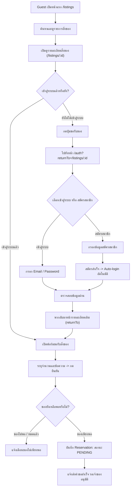
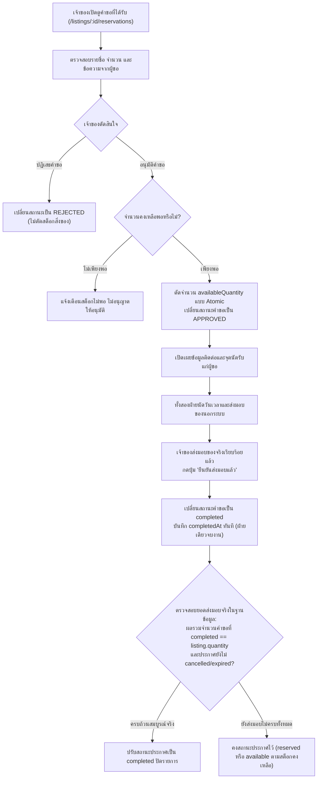
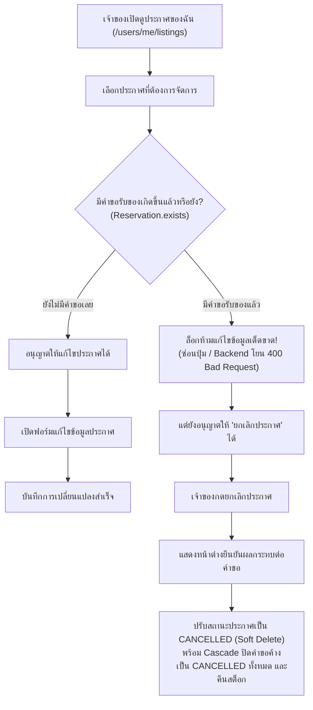

# Sharing Leftovers — Requirement & Web Application Design (ฉบับปรับปรุงตามระบบจริง)

เอกสารสรุปข้อกำหนดและการออกแบบระบบ · สำหรับวางแผนพัฒนาและนำเสนอในรายวิชา · Wireframe ขาวดำ · Responsive Desktop & Mobile

---

## 1. สรุปแนวคิดของระบบ

**Sharing Leftovers** คือเว็บแอปพลิเคชันสำหรับแบ่งปันสิ่งของที่ยังสามารถใช้งานได้ให้กับคนอื่นในพื้นที่ใกล้เคียง โดยเริ่มจากมหาวิทยาลัยและชุมชนรอบมหาวิทยาลัย เพื่อช่วยให้สิ่งของถูกนำกลับมาใช้ประโยชน์แทนการทิ้ง ลดปริมาณขยะ (Zero Waste) และส่งเสริมวัฒนธรรมการแบ่งปันภายในชุมชน

ภาพลักษณ์ของเว็บไซต์เป็นแบบ **Minimal + Friendly Community** เรียบง่าย ไม่ซับซ้อน ให้ความรู้สึกเป็นมิตรและไว้วางใจได้ เน้นความโปร่งใส ปลอดภัย และใช้งานสะดวกบนทุกอุปกรณ์

### หลักการออกแบบสำคัญ

1. **ค้นหาของได้ง่ายและเปิดกว้าง (Open Discovery):**
   ผู้เข้าชมทั่วไป (Guest) สามารถค้นหา กรอง และเปิดดูรายละเอียดสิ่งของที่แบ่งปันได้ทันทีโดยไม่ต้องเข้าสู่ระบบก่อน เพื่อเปิดโอกาสให้เห็นคุณค่าของสิ่งของได้อย่างสะดวก
2. **เข้าสู่ระบบอย่างลื่นไหลเมื่อต้องการทำรายการ (Frictionless Auth):**
   เมื่อผู้ใช้ตัดสินใจจะกด "ขอรับสิ่งของ" ระบบจึงจะนำทางไปยังหน้าเข้าสู่ระบบ/สมัครสมาชิกที่รวมอยู่ในหน้าเดียวกัน (`/auth`) และเมื่อสมัครสมาชิกสำเร็จ ระบบจะเข้าสู่ระบบให้อัตโนมัติพร้อมพากลับมายังประกาศเดิมทันที
3. **แบ่งปันและส่งมอบได้ชัดเจนในฝ่ายเดียว (One-Party Completion):**
   เจ้าของประกาศเป็นผู้ตัดสินใจอนุมัติคำขอ และเมื่อเกิดการส่งมอบสิ่งของจริง เจ้าของสามารถกดยืนยันว่าส่งมอบแล้ว (`Complete`) เพื่อปิดรายการได้ทันที ไม่ต้องรอยืนยันจากสองฝั่งให้ซ้ำซ้อน
4. **ความมั่นคงของข้อมูลคำขอ (Locked on Reservation):**
   เมื่อประกาศมีคำขอรับของเกิดขึ้นแล้ว จะไม่อนุญาตให้แก้ไขข้อมูลประกาศ เพื่อป้องกันความสับสนและข้อพิพาท แต่เจ้าของยังสามารถกดยกเลิกประกาศได้ตามสิทธิ์
5. **คุ้มครองข้อมูลส่วนตัวและสถานที่ (Privacy by Design):**
   ไม่แสดงพิกัดที่แม่นยำหรือที่อยู่นัดรับละเอียดแก่สาธารณะ โดยจะเปิดเผยข้อมูลสถานที่ติดต่อเฉพาะผู้ขอที่ได้รับการอนุมัติคำขอแล้วเท่านั้น

---

## 2. Requirement และข้อกำหนดทางเทคนิค

### 2.1 ประเด็นทางเทคนิค 3 ข้อที่ล็อกไว้ตั้งแต่ตอนออกแบบ (Core Technical Locks)

> [!IMPORTANT]
> กฎเหล็ก 3 ข้อนี้เป็นข้อกำหนดหลักที่ใช้แทนแนวคิดเดิม เพื่อให้ระบบกระชับ ชัดเจน และเหมาะสมกับสถาปัตยกรรมของโปรเจกต์จริง:
> 1. **Guest ดูรายละเอียดของได้ทันที:** ผู้ใช้ทั่วไปเปิดดูหน้ารายละเอียดสิ่งของ (`/listings/:id`) ได้เลย แต่เมื่อกดขอรับของ ระบบจะพาไปหน้า Login/Register รวม (`/auth?returnTo=...`) และเมื่อสมัครสมาชิกเสร็จ ระบบจะ Auto-login ให้อัตโนมัติและพากลับมาหน้าประกาศเดิม
> 2. **เจ้าของกดยืนยันส่งมอบจบงานฝ่ายเดียว (`COMPLETED`):** เจ้าของอนุมัติคำขอ (`APPROVED`) เพื่อกันสต็อก และเมื่อส่งมอบจริงแล้ว เจ้าของสามารถกดปุ่ม *"ยืนยันส่งมอบแล้ว"* เพื่อเปลี่ยนสถานะคำขอเป็น `COMPLETED` ได้ทันที โดยใช้ฟิลด์ `completedAt` ไม่ต้องรอการยืนยันจากสองฝั่ง
> 3. **มีคำขอแล้วห้ามแก้ไข แต่ยกเลิกประกาศได้:** เมื่อประกาศมีคำขอรับของเกิดขึ้นในระบบแล้ว จะถูกล็อกห้ามแก้ไขข้อมูลประกาศโดยเด็ดขาด แต่เจ้าของยังสามารถกดยกเลิกประกาศได้ (Soft Delete)

---

### 2.2 Functional Requirements (ตารางข้อกำหนดการทำงาน)

| ID | Requirement | รายละเอียดที่ระบบต้องรองรับ |
| :--- | :--- | :--- |
| **FR-01** | ค้นหาสิ่งของ | ค้นหาจากชื่อ (Text Search), หมวดหมู่, สภาพสิ่งของ, ระยะทางรอบตัว (GPS Radius) หรือตัวกรองพื้นที่ด้วยตนเอง (จังหวัด, อำเภอ, ตำบล) |
| **FR-02** | แสดงรายการสิ่งของ | การ์ดแสดงรูป ชื่อ สภาพ จำนวนคงเหลือ ระยะทาง พื้นที่โดยประมาณ และวันหมดอายุ |
| **FR-03** | เปิดดูรายละเอียดสาธารณะ | Guest สามารถเปิดดูรายละเอียดประกาศได้ทันที แต่ต้อง Login/Register ก่อนส่งคำขอรับของ |
| **FR-04** | รวมหน้ายืนยันตัวตน | รวม Login และ Register อยู่ในหน้าเดียวกัน (`/auth`) สลับ Tab ได้ สมัครเสร็จ Auto-login ทันที |
| **FR-05** | การส่งต่อ URL (ReturnTo) | จำหน้าที่ผู้ใช้กำลังทำรายการอยู่ เมื่อ Login/Register สำเร็จให้พากลับมาหน้าเดิมอัตโนมัติ |
| **FR-06** | ระบุตำแหน่งค้นหา | ขออนุญาตใช้พิกัดอุปกรณ์ (Geolocation) เพื่อค้นหาตามรัศมี (เมตร) พร้อมทางเลือกกรณีไม่อนุญาต |
| **FR-07** | ลงประกาศแบ่งปัน | สมาชิกสร้างประกาศพร้อมระบุชื่อ หมวดหมู่ สภาพ จำนวน รายละเอียด (จำเป็น) รูปภาพเป็น URL (1–5 รูป) จุดนัดรับ (Pickup เท่านั้น) และวันหมดอายุ |
| **FR-08** | ล็อกการแก้ไขประกาศ (Strict Edit Lock) | แก้ไขประกาศได้เฉพาะเจ้าของและเมื่อยังไม่มีคำขอรับของใดๆ หากมีคำขอแรกเกิดขึ้นแล้ว (`Reservation.exists`) จะล็อกห้ามแก้ไขเด็ดขาดทุกบทบาท (ทั้งเจ้าของ [409] และ Admin [403]) แต่ยังกดยกเลิกประกาศได้ |
| **FR-09** | ยกเลิกประกาศ (Soft Delete) | เจ้าของหรือ Admin ยกเลิกประกาศได้ โดยเปลี่ยนสถานะเป็น `cancelled` และจัดการคืนจำนวนอย่างถูกต้อง |
| **FR-10** | ขอรับสิ่งของ | สมาชิกระบุจำนวนและส่งข้อความ โดยผู้ใช้หนึ่งคนขอได้ครั้งเดียวตลอดอายุประกาศ (Compound Index `{ listing: 1, requester: 1 }` ขอซ้ำไม่ได้แม้ถูกปฏิเสธ/ยกเลิก และขอของตนเองไม่ได้) |
| **FR-11** | อนุมัติคำขอแบบ Atomic | เจ้าของเลือกอนุมัติคำขอ โดยระบบจะตัดสต็อกคงเหลือแบบ Atomic ป้องกันของหมดเกินจำนวน |
| **FR-12** | ปฏิเสธ/ยกเลิกคำขอ | เจ้าของปฏิเสธคำขอได้ และผู้ขอยกเลิกคำขอของตนเองได้ (หากเคยอนุมัติไว้ ระบบจะคืนสต็อกเข้าประกาศ) |
| **FR-13** | เปิดเผยจุดรับของหลังอนุมัติ | แสดงข้อมูลสถานที่นัดรับและเบอร์โทรติดต่อแก่ผู้ขอที่ได้รับการอนุมัติแล้วเท่านั้น |
| **FR-14** | ยืนยันส่งมอบฝ่ายเดียว | เจ้าของกดยืนยันเมื่อส่งมอบของจริง เพื่อปรับสถานะคำขอเป็น `completed` บันทึก `completedAt` |
| **FR-15** | ติดตามสถานะและประวัติ | สมาชิกดูรายการประกาศของตนเอง คำขอที่ได้รับ และคำขอที่ส่งไป พร้อมสถานะกำกับ |
| **FR-16** | รายงานปัญหา | สมาชิกแจ้งรายงานประกาศที่ไม่เหมาะสมพร้อมระบุเหตุผล (Spam, Fraud, Illegal ฯลฯ) |
| **FR-17** | จัดการระบบโดย Admin | ผู้ดูแลระบบสามารถระงับ/ปลดระงับผู้ใช้งาน (ห้ามแก้ไขฟิลด์ `role` ผ่านระบบเพื่อป้องกัน Privilege Escalation), จัดการหมวดหมู่, ตรวจสอบรายงาน และระงับประกาศที่ผิดกฎ |
| **FR-18** | การตอบสนองผ่าน UI | แจ้งเตือนผลการทำรายการผ่าน Toast Notification และ Modal โดยไม่ต้องโหลดหน้าเว็บใหม่โดยไม่จำเป็น |
| **FR-19** | รองรับทุกขนาดหน้าจอ | ใช้งานได้สมบูรณ์ทั้ง Desktop และ Mobile ด้วย Responsive Design |

---

### 2.3 Non-functional Requirements

- **ความปลอดภัย (Security):** ใช้ระบบ Session Authentication ที่เก็บ session ลง MongoDB ป้องกัน session หลุดเมื่อรีสตาร์ท, ปิดการเข้าถึงข้อมูลลับ เช่น รหัสผ่านถูก Masking ทิ้งอัตโนมัติ (`toJSON transform delete passwordHash`)
- **ความถูกต้องของข้อมูล (Data Consistency & Concurrency):** การอนุมัติคำขอใช้ Atomic Operation (`findOneAndUpdate` พร้อมเงื่อนไข `$gte` และ `$inc`) เพื่อป้องกันปัญหา Race Condition
- **ความเป็นส่วนตัว (Privacy):** ซ่อนพิกัดแม่นยำและที่อยู่เต็มจากผู้ใช้ทั่วไป แสดงเฉพาะระดับตำบล/อำเภอ/จังหวัด หรือระยะทางโดยประมาณ
- **การจัดการความผิดพลาด (Graceful Error Handling):** ดักจับ Error ด้วย HTTP Status Code ที่ถูกต้อง (400, 401, 403, 404, 409, 500) และแสดงข้อความแจ้งเตือนที่เข้าใจง่าย
- **นโยบายการลบข้อมูล (Soft Deletion Policy):**
  - ประกาศที่ถูกลบ $\rightarrow$ ปรับ `status: "cancelled"`
  - บัญชีที่ถูกปิด $\rightarrow$ ปรับ `isActive: false`
  - หมวดหมู่ที่มีประกาศผูกอยู่ $\rightarrow$ ปรับ `isActive: false` แทนการลบแถวข้อมูลจริง

---

## 3. Sitemap — โครงสร้างหน้าของเว็บไซต์

โครงสร้างหน้าเว็บแบ่งตามบทบาทของผู้ใช้งาน โดยสมาชิกทุกคนสามารถทำหน้าที่เป็นทั้งผู้แบ่งปันและผู้ขอรับสิ่งของได้ในบัญชีเดียว:

```text
Sharing Leftovers
│
├── 1. หน้าสาธารณะ (Public & Guest)
│   ├── หน้าแรก (/)
│   ├── ค้นหาและดูรายการสิ่งของ (/listings)
│   ├── หน้ารายละเอียดสิ่งของ (/listings/:id)  <-- Guest เข้าดูได้ทันที
│   └── หน้าเข้าสู่ระบบและสมัครสมาชิก (/auth)  <-- รวม Login และ Register ในหน้าเดียว
│
├── 2. พื้นที่สมาชิก (Member Space)
│   ├── แดชบอร์ด / พื้นที่ของฉัน (/dashboard หรือ My Space Panel)
│   │   ├── ข้อมูลโปรไฟล์ตนเอง (/users/me)
│   │   ├── ประกาศของฉัน (/users/me/listings)
│   │   ├── คำขอรับของของฉัน (/reservations/my)
│   │   └── เปลี่ยนรหัสผ่าน (/auth/password)
│   ├── ลงประกาศใหม่ (/listings/new หรือ Create Modal)
│   ├── แก้ไขประกาศ (/listings/:id/edit)       <-- ล็อกห้ามแก้ถ้ามีคำขอแล้ว
│   └── จัดการคำขอที่ได้รับในประกาศ (/listings/:id/reservations)
│
└── 3. พื้นที่ผู้ดูแลระบบ (Admin Space)
    ├── หน้าภาพรวมผู้ดูแลระบบ (/admin)
    ├── ตารางจัดการและค้นหาประกาศสิ่งของ (/admin/listings)
    ├── จัดการสมาชิกในชุมชน (/admin/users)
    ├── จัดการหมวดหมู่สิ่งของ (/admin/categories)
    └── ตรวจสอบรายงานปัญหา (/admin/reports)
```

---

## 4. Page Specifications & Wireframes

### 4.1 หน้าแรก — Home (`/`) และ หน้าค้นหา (`/listings`)

* **สิทธิ์การเข้าถึง:** สาธารณะ (ทุกคนเข้าถึงได้)
* **วัตถุประสงค์:** นำเสนอสิ่งของที่กำลังแบ่งปัน ค้นหาและกรองสิ่งของตามหมวดหมู่ สภาพ และระยะทางใกล้ตัว
* **องค์ประกอบหลัก:**
  * **Header:** แบรนด์ Logo, เมนูค้นหา, ปุ่ม "เข้าสู่ระบบ", ปุ่ม "เริ่มแบ่งปัน", หรือข้อมูลโปรไฟล์เมื่อล็อกอินแล้ว
  * **Hero Section:** ข้อความรณรงค์การแบ่งปันในชุมชน พร้อมทางลัดเริ่มค้นหา
  * **Search & Filter Bar:** ช่องพิมพ์คำค้นหา (Text Search), Dropdown เลือกหมวดหมู่, Dropdown เลือกสภาพสินค้า, ตัวเลือกจัดเรียง (มาใหม่, ยอดนิยม, ใกล้หมดเวลา), ปุ่มใช้พิกัดปัจจุบัน (GPS Radius) และตัวกรองพื้นที่ด้วยตนเอง (จังหวัด, อำเภอ, ตำบล เมื่อไม่เปิด GPS)
  * **Listing Grid:** แสดงรายการการ์ดสิ่งของ (รูปภาพ, ชื่อ, หมวดหมู่, สภาพ, จำนวนคงเหลือ, พื้นที่โดยประมาณ)
  * **Pagination:** ปุ่มเลื่อนหน้าก่อนหน้า/ถัดไป และสรุปจำนวนหน้า

```text
+-----------------------------------------------------------------------+
|  [SL] Sharing Leftovers            ค้นหาของ   พื้นที่ของฉัน   [เข้าสู่ระบบ]  |
+-----------------------------------------------------------------------+
|                                                                       |
|   ของเหลือจากเรา อาจเป็นของพอดีสำหรับใครอีกคน                               |
|   [ เลือกดูของที่แบ่งปัน v ]     [ + ลงประกาศแบ่งปัน ^ ]                     |
|                                                                       |
+-----------------------------------------------------------------------+
|  ค้นหา: [ โต๊ะทำงาน....... ] [ หมวดหมู่ v ] [ สภาพ v ] [ เรียงลำดับ v ] (O) GPS |
+-----------------------------------------------------------------------+
|  +--------------------+  +--------------------+  +--------------------+  |
|  | [   รูปภาพของ   ]   |  | [   รูปภาพของ   ]   |  | [   รูปภาพของ   ]   |  |
|  | เฟอร์นิเจอร์ · สภาพดี   |  | อาหารสด · สภาพใหม่  |  | หนังสือ · พอใช้     |  |
|  | โต๊ะเขียนหนังสือไม้   |  | ขนมปังโฮลวีต 2 แถว  |  | ตำราเรียนฟิสิกส์     |  |
|  | เหลือ 1 ชิ้น · 5 กม. |  | เหลือ 2 ชิ้น · 1 กม. |  | เหลือ 1 ชิ้น · 3 กม. |  |
|  | [ ดูรายละเอียด -> ]|  | [ ดูรายละเอียด -> ]|  | [ ดูรายละเอียด -> ]|  |
|  +--------------------+  +--------------------+  +--------------------+  |
+-----------------------------------------------------------------------+
```

---

### 4.2 หน้ารวมยืนยันตัวตน — Auth Page / Modal (`/auth`)

* **สิทธิ์การเข้าถึง:** สาธารณะ (ผู้ที่ยังไม่ล็อกอิน)
* **วัตถุประสงค์:** รวมหน้าเข้าสู่ระบบ (Login) และสมัครสมาชิก (Register) ไว้ในหน้าเดียว โดยมี Tab ให้สลับใช้งานง่าย และรองรับ parameter `returnTo` เพื่อพากลับไปยังประกาศเดิมอัตโนมัติ

```text
+-------------------------------------------------------------+
|                     Sharing Leftovers                       |
|           เข้าสู่ระบบเพื่อเริ่มส่งต่อและขอรับของแบ่งปัน            |
|                                                             |
|           [ เข้าสู่ระบบ (Active) ]   [ สมัครสมาชิก ]          |
|                                                             |
|   อีเมล:                                                    |
|   [ user@example.com..................................... ] |
|                                                             |
|   รหัสผ่าน:                                                  |
|   [ ********............................................. ] |
|                                                             |
|   [            เข้าสู่ระบบและดำเนินการต่อ ->            ]    |
|                                                             |
|   * หากสมัครสมาชิกใหม่ ระบบจะเข้าสู่ระบบให้อัตโนมัติทันที           |
+-------------------------------------------------------------+
```

* **กติกาการทำงาน:**
  1. เมื่อส่งฟอร์ม Login สำเร็จ $\rightarrow$ ออก Session Cookie และ Redirect ไปที่ `returnTo` (หรือ `/dashboard`)
  2. เมื่อส่งฟอร์ม Register สำเร็จ $\rightarrow$ เข้ารหัสรหัสผ่าน บันทึกลงฐานข้อมูล สร้าง Session ให้ทันที (Auto-login) และ Redirect ไปที่ `returnTo`

---

### 4.3 หน้ารายละเอียดสิ่งของ — Listing Detail (`/listings/:id`)

* **สิทธิ์การเข้าถึง:** สาธารณะ (Guest ดูได้) แต่การขอรับของต้องเป็นสมาชิก
* **วัตถุประสงค์:** แสดงรายละเอียดของสิ่งของ เงื่อนไขการรับ และเป็นจุดเริ่มต้นการส่งคำขอรับของ
* **การแสดงผลตามบทบาท (Privacy by Design):**
  * **Guest:** สามารถดูรายละเอียดสิ่งของได้ครบถ้วนในส่วนข้อมูลประกาศ แต่ไม่สามารถดูที่อยู่นัดรับแบบละเอียด พิกัดที่แม่นยำ หรือข้อมูลติดต่อส่วนตัวได้ (แสดงเพียงพื้นที่ระดับอำเภอ/ตำบล หรือระยะทางโดยประมาณ) และปุ่ม Action จะแสดงข้อความว่า `[ เข้าสู่ระบบเพื่อขอรับ ]` (คลิกแล้วพาไป `/auth?returnTo=/listings/:id?action=claim`)
  * **สมาชิกทั่วไป (ไม่ใช่เจ้าของ):** แสดงปุ่ม `[ ขอรับของชิ้นนี้ ]` (หากเคยส่งคำขอในประกาศนี้แล้ว ปุ่มจะถูกปิดการใช้งาน และแสดงข้อความแจ้งเตือนว่า *"คุณเคยส่งคำขอสำหรับสิ่งของชิ้นนี้ไปแล้ว"*) และปุ่ม `[ แจ้งประกาศไม่เหมาะสม ]` (ยังไม่เห็นพิกัดละเอียดหรือเบอร์โทร จนกว่าจะได้รับอนุมัติคำขอ)
  * **เจ้าของประกาศ:** แสดงปุ่ม `[ ดูคำขอที่ได้รับ ]`, `[ แก้ไขประกาศ ]` (เฉพาะกรณีที่ยังไม่มีคำขอ) และ `[ ยกเลิกประกาศ ]`

```text
+-----------------------------------------------------------------------+
|  < ย้อนกลับไปหน้ารายการ                                                   |
+------------------------------------+----------------------------------+
|                                    | หมวดหมู่: เฟอร์นิเจอร์ · สภาพดี       |
|                                    |                                  |
|   [                                ] โต๊ะทำงานไม้สักแท้ สภาพ 90%        |
|   [         รูปภาพสิ่งของ           ] -------------------------------- |
|   [                                ] รายละเอียด:                      |
|   [                                ] โต๊ะขนาด 120x60 ซม. สภาพดีมาก     |
|                                    | มีรอยขีดข่วนเล็กน้อยตามการใช้งาน   |
|                                    | ต้องการส่งต่อเพราะย้ายหอพักครับ    |
|                                    | -------------------------------- |
|                                    | • จำนวนที่แบ่งปัน: เหลือ 1 จาก 1 ชิ้น |
|                                    | • พื้นที่นัดรับ: บริเวณหลัง ม. (5 กม.)|
|                                    | • วันหมดอายุประกาศ: 30 พ.ย. 2026  |
|                                    | • แบ่งปันโดย: สมชาย (สมาชิกชุมชน)  |
|                                    | -------------------------------- |
|                                    | [        ขอรับของชิ้นนี้        ] |
|                                    | [ ! แจ้งประกาศไม่เหมาะสม ]        |
+------------------------------------+----------------------------------+
```

---

### 4.4 หน้าลงประกาศ — Create Listing (`/listings/new`)

* **สิทธิ์การเข้าถึง:** สมาชิกที่เข้าสู่ระบบแล้ว
* **ฟิลด์ข้อมูลที่ต้องระบุ (Validation Rules):**
  * ชื่อสิ่งของ (จำเป็น)
  * หมวดหมู่อ้างอิงตาม Category (จำเป็น)
  * สภาพสิ่งของ: `new`, `like_new`, `good`, `fair`, `poor` (จำเป็น)
  * จำนวนที่นำมาแบ่งปัน (จำเป็น, จำนวนเต็ม $\ge 1$)
  * รายละเอียดสิ่งของ (จำเป็น เพื่อความชัดเจนและโปร่งใส)
  * รูปภาพประกอบ (ระยะ MVP รับเป็น **URL รูปภาพ** ตรวจสอบรูปแบบ `http://` หรือ `https://` บังคับอย่างน้อย 1 รูป และสูงสุด 5 รูป Array of Strings เพื่อรองรับการสลับไปใช้ระบบอัปโหลดไฟล์จริงในอนาคต)
  * วิธีรับของ (กำหนดเป็น **นัดรับด้วยตนเอง `pickup` เท่านั้น**) และระบุที่อยู่นัดรับ (ข้อมูลนัดรับละเอียดและพิกัดจะถูก Masked และเปิดเผยแก่ผู้ขอที่ได้รับการอนุมัติเท่านั้น)
  * พิกัดจุดรับของ (GeoJSON Point `[lng, lat]`)
  * วันหมดอายุประกาศ (จำเป็น ต้องระบุวันที่ในอนาคต)

---

### 4.5 หน้าแก้ไขประกาศ — Edit Listing (`/listings/:id/edit`)

* **สิทธิ์การเข้าถึง:** เจ้าของประกาศ (เฉพาะกรณีที่ยังไม่มีคำขอรับของ) / Admin ถูกปฏิเสธ (403 Forbidden ห้ามแก้ไขข้อมูลประกาศผู้อื่น)
* **กติกาสำคัญ (Technical Lock #3 - Strict Edit Lock):**
  * **กรณีที่ 1: ยังไม่มีคำขอรับของเลย** $\rightarrow$ เจ้าของสามารถแก้ไขข้อมูล ชื่อ รายละเอียด สภาพ รูปภาพ และสถานที่รับของได้ตามปกติ (Admin ไม่มีสิทธิ์แก้ไข)
  * **กรณีที่ 2: มีคำขอรับของเกิดขึ้นในระบบแล้ว (แม้เพียง 1 คำขอ และอยู่ในสถานะใดก็ตาม)** $\rightarrow$ **ระบบจะล็อกฟอร์มและปฏิเสธการแก้ไขโดยเด็ดขาดสำหรับทุกบทบาท (ทั้งเจ้าของและ Admin)** เพื่อป้องกันการบิดเบือนข้อมูลหรือเปลี่ยนสภาพของหลังจากมีผู้ขอรับไปแล้ว แต่ยังคงมีสิทธิ์กดปุ่ม **"ยกเลิกประกาศ"** (Soft Delete $\rightarrow$ `cancelled`) ได้

---

### 4.6 หน้าจัดการคำขอที่ได้รับ — Received Requests (`/listings/:id/reservations`)

* **สิทธิ์การเข้าถึง:** เฉพาะเจ้าของประกาศเท่านั้น
* **การแสดงผล:** แสดงรายการผู้ที่ส่งคำขอรับของเข้ามา พร้อมข้อความ จำนวนที่ขอ และสถานะ
* **ปุ่ม Action สำหรับเจ้าของ:**
  * เมื่อคำขอเป็น `PENDING`: แสดงปุ่ม `[ อนุมัติ (Approve) ]` และ `[ ปฏิเสธ (Reject) ]`
  * เมื่อคำขอเป็น `APPROVED`: แสดงข้อมูลติดต่อผู้ขอ พร้อมปุ่ม **`[ ยืนยันส่งมอบแล้ว (Complete) ]`**
  * เมื่อคำขอเป็น `COMPLETED`: แสดงป้ายกำกับว่า *"ส่งมอบสำเร็จแล้ว"* พร้อมเวลาที่ส่งมอบ

---

## 5. User Flows — ขั้นตอนการทำงานหลักของระบบ

### Flow 1: ผู้เข้าชมค้นหา $\rightarrow$ Login/Register $\rightarrow$ ขอรับสิ่งของ



---

### Flow 2: เจ้าของจัดการคำขอ $\rightarrow$ อนุมัติ $\rightarrow$ ยืนยันส่งมอบเสร็จสิ้น



---

### Flow 3: การแก้ไขและยกเลิกประกาศ (Edit & Cancel Policy)



---

## 6. โครงสร้างสถานะข้อมูล (Data State Machine)

### 6.1 สถานะของคำขอรับของ (`Reservation Status`)

| สถานะ | ความหมายและการทำงาน |
| :--- | :--- |
| **`pending`** | คำขอถูกส่งแล้ว รอเจ้าของประกาศพิจารณา (สต็อกยังไม่ถูกตัด) |
| **`approved`** | เจ้าของอนุมัติคำขอแล้ว สต็อกถูกตัดกันไว้ (`availableQuantity` ลดลงแบบ Atomic) และเปิดเผยจุดนัดรับ |
| **`rejected`** | เจ้าของปฏิเสธคำขอ (สต็อกไม่เปลี่ยนแปลงเพราะไม่เคยตัด) |
| **`cancelled`** | ผู้ขอยกเลิกคำขอเอง หรือถูกยกเลิกอัตโนมัติ (Cascade Cancellation) เมื่อประกาศถูกปิด/ยกเลิก (คำขอ `pending` ถูกยกเลิก และคำขอ `approved` ได้รับการคืนสต็อกเข้าประกาศ 1 ครั้งอย่างปลอดภัย) |
| **`completed`** | เจ้าของกดยืนยันการส่งมอบสำเร็จแล้ว บันทึก `completedAt` ปิดรายการคำขอโดยสมบูรณ์ |

### 6.2 สถานะของประกาศแบ่งปัน (`Listing Status`)

| สถานะ | ความหมายและการทำงาน |
| :--- | :--- |
| **`available`** | ประกาศเปิดรับคำขอ มีของคงเหลือพร้อมแบ่งปัน (`availableQuantity > 0`) |
| **`reserved`** | ของถูกอนุมัติจองครบตามจำนวนแล้ว (`availableQuantity === 0`) รอการส่งมอบจริงชั่วคราว (ยังไม่ใช่ `completed`) |
| **`completed`** | สิ่งของทั้งหมดได้รับการส่งมอบสำเร็จครบถ้วนจริง ($\sum_{\text{completed}} \text{quantity} = \text{listing.quantity}$) และประกาศยังไม่ cancelled หรือ expired ปิดประกาศสมบูรณ์ |
| **`cancelled`** | ประกาศถูกยกเลิกโดยเจ้าของหรือผู้ดูแลระบบ (Soft delete) พร้อม Cascade ปิดคำขอที่ค้างอยู่ |
| **`expired`** | ประกาศหมดอายุตามวันที่ระบุ (`expiresAt`) |

---

## 7. สถาปัตยกรรมโปรเจกต์และการเชื่อมโยงกับโค้ดจริง (Implementation Alignment)

โครงสร้างโฟลเดอร์ของโปรเจกต์ถูกจัดวางตามรูปแบบมาตรฐาน MVC และ RESTful API:

```text
Sharing-Leftovers/
├── server.js                        # Entry point เชื่อมต่อ DB และเริ่ม Express
├── package.json                     # กำหนด dependencies และสคริปต์
│
├── frontend/                        # ฝั่งการแสดงผล (Presentation Layer)
│   ├── public/
│   │   ├── css/app.css              # สไตล์หน้าเว็บ Responsive Design
│   │   └── js/app.js                # ควบคุมการเรียก API (Fetch), Modal, Geolocation
│   └── views/
│       ├── home.ejs                 # เทมเพลต EJS หน้าแรกและแผงควบคุมหลัก
│       ├── partials/                # ชิ้นส่วน UI นำกลับมาใช้ซ้ำ (header, footer, card)
│       ├── pages/                   # หน้าเว็บแยก (auth, listings, dashboard)
│       └── errors/                  # หน้าแจ้งเตือนข้อผิดพลาด (404.ejs, 500.ejs)
│
└── src/                             # โค้ดส่วนหลังบ้าน (Application Layer)
    ├── app.js                       # ตั้งค่า Middlewares, Session, Routes, Swagger
    ├── seed.js                      # สคริปต์ Seed หมวดหมู่เริ่มต้น 7 หมวดหมู่
    ├── config/
    │   ├── database.js              # เชื่อมต่อ MongoDB ผ่าน Mongoose
    │   └── swagger.js               # ตั้งค่า Swagger OpenAPI 3.0.3 spec
    ├── middlewares/
    │   ├── auth.js                  # requireAuth (ตรวจ session), requireAdmin (ตรวจ role)
    │   ├── ApiError.js              # Custom Error Class ระบุ status code
    │   └── errorHandler.js          # Global Error Handler ดักจับ ValidationError, CastError ฯลฯ
    ├── models/                      # Mongoose Schema
    │   ├── User.js                  # สมาชิกและสิทธิ์, GeoJSON location, รหัสผ่าน hash
    │   ├── Category.js              # หมวดหมู่สิ่งของ
    │   ├── Listing.js               # ประกาศสิ่งของ, สภาพ, สต็อก, พิกัดสถานที่
    │   ├── Reservation.js           # คำขอรับของ, สถานะ, completedAt
    │   └── Report.js                # รายงานปัญหาประกาศ
    ├── controllers/                 # Business Logic
    │   ├── auth.controller.js       # register (auto-login), login, me, logout, password
    │   ├── user.controller.js       # getMe, updateMe, deleteMe, getMyListings, admin functions
    │   ├── category.controller.js   # listCategories, createCategory, updateCategory, deleteCategory
    │   ├── listing.controller.js    # getListings, getListing, createListing, updateListing, deleteListing
    │   ├── reservation.controller.js# createReservation, approveReservation, completeReservation, cancel, reject
    │   └── report.controller.js     # createReport, listReports, updateReport (admin)
    └── routes/                      # Route กำหนด API Endpoint
        ├── auth.routes.js           # /api/v1/auth
        ├── user.routes.js           # /api/v1/users
        ├── category.routes.js       # /api/v1/categories
        ├── listing.routes.js        # /api/v1/listings
        ├── reservation.routes.js    # /api/v1/reservations
        └── report.routes.js         # /api/v1/reports
```

---

## 8. สรุปความเปลี่ยนแปลงจากข้อกำหนดฉบับเดิม (Changelog & Revision History)

| ประเด็น | ข้อกำหนดเดิม (Previous Draft) | ข้อกำหนดฉบับปรับปรุง (Current Approved) | เหตุผลในการปรับปรุง |
| :--- | :--- | :--- | :--- |
| **การเข้าถึงรายละเอียด** | Guest ดูรายละเอียดไม่ได้ ต้อง Login ก่อนเปิดดู | **Guest ดูรายละเอียดประกาศได้ทันที** แต่ต้อง Login ก่อนกดส่งคำขอรับของ | เปิดโอกาสให้เห็นของแบ่งปันก่อน เพิ่มแรงจูงใจในการสมัครใช้งาน |
| **หน้า Authentication** | แยกหน้า `/login` และ `/register` ต่างหาก | **รวม Login และ Register อยู่ในหน้าเดียวกัน (`/auth`)** สลับแท็บได้ และสมัครเสร็จ Auto-login ทันที | ลดขั้นตอนผู้ใช้ ไม่ต้องกรอกรหัสผ่านซ้ำสองรอบ และพากลับมาหน้าเดิมได้ลื่นไหล |
| **การยืนยันส่งมอบ** | ยืนยันสองฝ่าย (เจ้าของและผู้รับต้องกดยืนยันทั้งคู่) | **เจ้าของกดยืนยันส่งมอบฝ่ายเดียว (`COMPLETED`)** ผ่านฟิลด์ `completedAt` | ลดความยุ่งยากเมื่อนัดรับของจริงเสร็จสิ้น และสอดคล้องกับ Controller ปัจจุบัน |
| **การแก้ไขประกาศ** | แก้ไขประกาศได้ตลอดถ้าปรับจำนวนไม่ต่ำกว่ายอดจอง | **ล็อกห้ามแก้ไขเด็ดขาดเมื่อมีคำขอเกิดขึ้นแล้ว** แต่ยังกดยกเลิกประกาศได้ | ป้องกันผู้แบ่งปันแอบเปลี่ยนสภาพหรือรายละเอียดของหลังมีคนขอรับไปแล้ว |
| **การตั้งชื่อ Resource** | ใช้คำว่า `/items` ในหลายส่วนของเอกสาร | **เปลี่ยนเป็น `/listings` ทั้งหมด** | ตรงตามมาตรฐานของ REST API, Model, และ Controller ในโค้ดจริง |
| **การแจ้งเตือน** | ระบุว่าต้องมีหน้า `/notifications` และโมเดลแยก | **ใช้ In-app Toast Feedback และ Badges บนหน้ารายการคำขอ** | ลดความซับซ้อนที่ไม่จำเป็นสำหรับขอบเขตงาน MVP |
| **นโยบายการลบข้อมูล** | ไม่ได้ระบุชัดเจน | **กำหนด Soft Delete Policy ชัดเจน** (Listing $\rightarrow$ `cancelled`, User $\rightarrow$ `isActive: false`) | รักษาความสมบูรณ์ของฐานข้อมูลและประวัติการทำรายการย้อนหลัง |

---

## 9. เกณฑ์ตรวจรับงาน (MVP Acceptance Checklist)

- [ ] **การค้นหาและเข้าถึง:** ผู้ใช้ทั่วไปค้นหาและเปิดดูหน้ารายละเอียดสิ่งของได้โดยไม่ต้องเข้าสู่ระบบ
- [ ] **การยืนยันตัวตน:** เมื่อกดขอรับของ ระบบพาไปหน้า `/auth` พร้อมสลับ Login/Register ได้ และเมื่อสมัครเสร็จระบบเข้าสู่ระบบให้ทันทีพร้อมพากลับมาที่ประกาศเดิม
- [ ] **การลงประกาศ:** สมาชิกลงประกาศใหม่พร้อมรูปภาพ สภาพ และสถานที่รับของได้ถูกต้อง
- [ ] **การล็อกการแก้ไข:** ประกาศที่มีคำขอรับของแล้ว จะไม่สามารถแก้ไขข้อมูลได้ แต่ยังคงกดยกเลิกประกาศได้
- [ ] **การขอรับของ:** สมาชิกส่งคำขอรับของได้ (ขอของตัวเองไม่ได้ และขอซ้ำในประกาศเดิมไม่ได้)
- [ ] **การอนุมัติและตัดสต็อก:** เจ้าของกดอนุมัติคำขอได้ โดยระบบตัดจำนวนคงเหลือแบบ Atomic ป้องกันของหมดเกินจำนวน
- [ ] **การส่งมอบสำเร็จ:** เมื่อส่งมอบของจริง เจ้าของสามารถกดยืนยันส่งมอบเพื่อเปลี่ยนสถานะคำขอเป็น `COMPLETED` ได้ทันทีฝ่ายเดียว
- [ ] **การจัดการหลังบ้าน:** ผู้ดูแลระบบ (Admin) สามารถตรวจสอบรายงานปัญหา จัดการหมวดหมู่ และระงับผู้ใช้งานได้
- [ ] **ความปลอดภัย:** ไม่เปิดเผยรหัสผ่าน (`passwordHash` ถูก Masking ทิ้ง) และไม่เปิดเผยที่อยู่นัดรับละเอียดแก่ผู้ที่ยังไม่ได้รับอนุมัติ