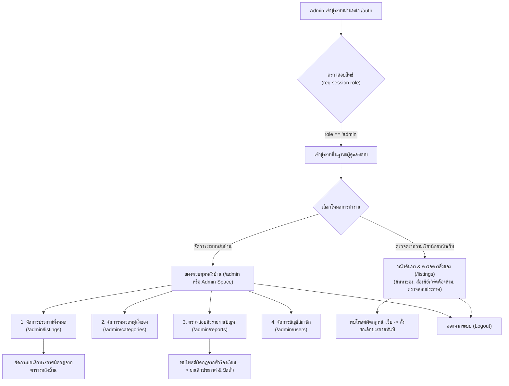
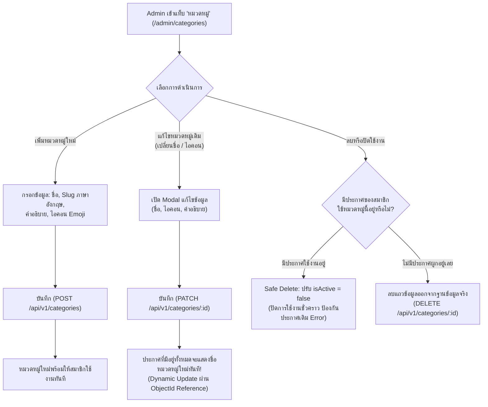
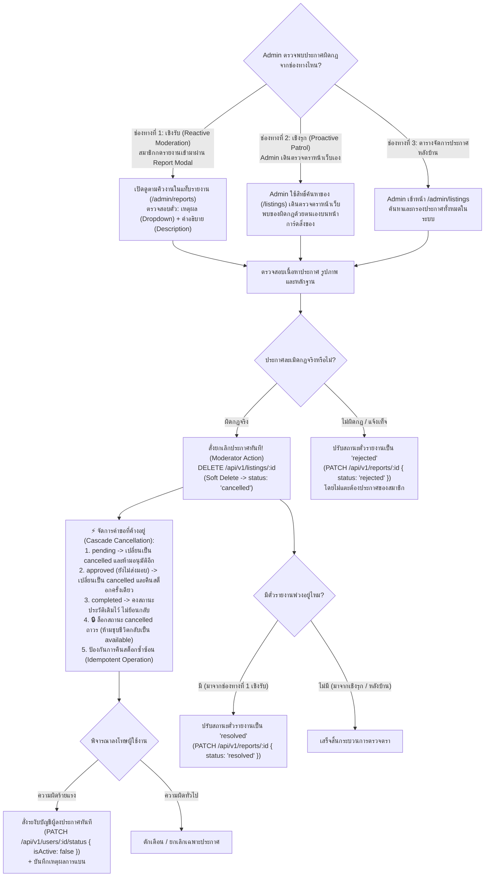
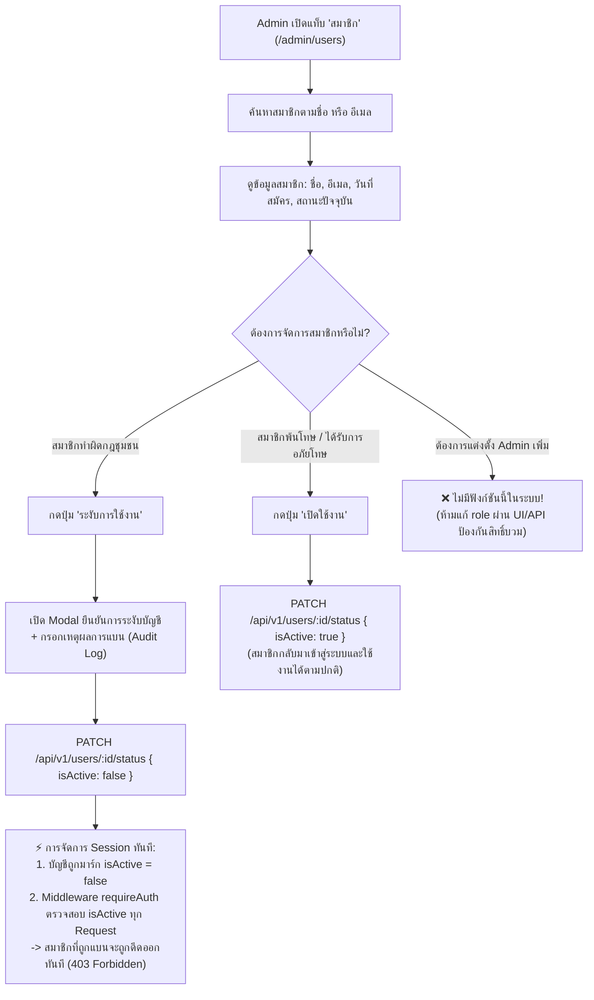

# Sharing Leftovers — Admin Workflow & System Operations (Admin Flow)

เอกสารสรุปขั้นตอนการทำงาน ลำดับการใช้งาน (User Flow) และสิทธิ์การจัดการระบบสำหรับ **ผู้ดูแลระบบ (Admin)** ตามหลักการ **Strict Back-office Administrator** (แยกผู้ดูแลระบบหลังบ้านออกจากผู้ใช้งานทั่วไปอย่างเด็ดขาด) พร้อมปรับปรุงความสอดคล้องระดับ Production-Ready (P0, P1, P2)

---

## 1. บทบาทและข้อจำกัดของ Admin (Admin Concept & Product Decision)

ในระบบ Sharing Leftovers บทบาทของ **Admin** ถูกกำหนดให้เป็น **"ผู้คุมกฎและจัดการหลังบ้าน (Back-office Operator & Community Auditor)"** โดยมีข้อกำหนดความปลอดภัยที่เข้มงวด:

> [!NOTE]
> **การตัดสินใจด้านผลิตภัณฑ์ (Product Decision):**
> การตัดสิทธิ์ไม่ให้ Admin ลงประกาศหรือขอรับของ เป็นการตัดสินใจเชิงสถาปัตยกรรมผลิตภัณฑ์เพื่อ **ป้องกันผลประโยชน์ทับซ้อน (Conflict of Interest)** และรักษาความโปร่งใสในชุมชน หากในอนาคตผู้ดูแลระบบต้องการมีส่วนร่วมในการแบ่งปันของ ให้ใช้บัญชีสมาชิกทั่วไป (`User Account`) แยกอีกบัญชีหนึ่งต่างหาก โดยไม่ปะปนกับบัญชีแอดมินหลังบ้าน

### 🚫 สิ่งที่ ADMIN ไม่สามารถทำได้ (Strictly Prohibited):
1. **ห้ามลงประกาศแบ่งปันสิ่งของ:** ไม่สามารถกดสร้างประกาศเองได้ (`POST /api/v1/listings` ถูกบล็อก 403 Forbidden)
2. **ห้ามส่งคำขอรับของจากสมาชิก:** ไม่สามารถขอรับของจากใครได้ (`POST /api/v1/listings/:id/reservations` ถูกบล็อก 403 Forbidden)
3. **ไม่มีพื้นที่ "ประกาศของฉัน" หรือ "คำขอของฉัน":** ไม่มี Listing ที่ตนเองเป็น Owner และไม่มีคำขอของตนเองในระบบ
4. **ห้ามแก้ไขข้อมูลประกาศของสมาชิก:** เมื่อประกาศมีคำขอเกิดขึ้นแล้ว **ทุกบทบาท (รวมถึง Admin) ห้ามแก้ไขข้อมูลประกาศเด็ดขาด** (`PATCH /api/v1/listings/:id` ถูกบล็อก 403) หากประกาศผิดกฎให้ใช้การยกเลิกประกาศแทน
5. **ห้ามแต่งตั้งหรือปลดสิทธิ์ Admin ด้วยกันเอง:** Admin ไม่สามารถเปลี่ยนฟิลด์ `role` ของสมาชิกคนใดให้เป็น Admin ได้ เพื่อป้องกันการยึดระบบหรือการปั๊มสิทธิ์โดยมิชอบ (การกำหนดสิทธิ์ Admin จะต้องทำผ่านระดับ Database / System Configuration โดยตรงเท่านั้น)

### 🛡️ สิ่งที่ ADMIN ทำได้ (Back-office & Moderation Responsibilities):
1. **ค้นหาและตรวจดูสิ่งของบนหน้าเว็บ (Public Search & Patrol):** เดินตรวจตรา ค้นหาคีย์เวิร์ดต้องห้าม และดูรายละเอียดสิ่งของบนหน้าเว็บสาธารณะได้ตามปกติ เพื่อทำหน้าที่สอดส่องชุมชน
2. **จัดการประกาศในหลังบ้าน (`/admin/listings`):** มีหน้าค้นหา กรอง และจัดการประกาศทั้งหมดในระบบหลังบ้านโดยเฉพาะ
3. **จัดการหมวดหมู่สิ่งของ (`/admin/categories`):** เพิ่ม, แก้ไข, เปิด/ปิดการใช้งานหมวดหมู่
4. **กำกับดูแลและยกเลิกประกาศที่ผิดกฎ (Unified Listing Moderation):** ดำเนินการยกเลิกประกาศที่ผิดกฎชุมชน (`status: "cancelled"`) ทั้งแบบเชิงรับ (ผ่านเรื่องร้องเรียน `/admin/reports`) และเชิงรุก (ตรวจพบเอง) พร้อมระบบ Cascade Cancellation จัดการคำขอที่ค้างอยู่ และ **ล็อกไม่ให้ประกาศฟื้นคืนชีพกลับมาเปิดรับใหม่**
5. **จัดการสมาชิก (`/admin/users`):** ตรวจสอบรายชื่อสมาชิก และสั่ง **ระงับบัญชี (Ban: `isActive: false`)** หรือ **ปลดระงับ (Unban: `isActive: true`)** พร้อมตัด Session การใช้งานทันที

---

## 2. แผนภาพรวมการเดินทางของ Admin (Admin Journey Overview)



---

## 3. รายละเอียดขั้นตอนการทำงานหลัก (Admin Core Flows)

---

### Flow 1: การจัดการหมวดหมู่สิ่งของ (Category Management Flow)

Admin ทำหน้าที่จัดเตรียมและดูแลประเภทของสิ่งของสำหรับทั้งระบบ



#### 💡 ประเด็นสำคัญเรื่องการแก้ไขชื่อหมวดหมู่ (Dynamic Update):
* ใน [src/models/Listing.js](file:///c:/Users/acer/Downloads/DataSer/working/Sharing-Leftovers/src/models/Listing.js) โพสต์เก็บหมวดหมู่เป็น **`ObjectId Reference`** (`ref: "Category"`):
  ```javascript
  category: { type: mongoose.Schema.Types.ObjectId, ref: "Category", required: true }
  ```
* เมื่อแสดงผลหน้าเว็บ ระบบใช้ `.populate("category")` ดึงชื่อและไอคอนล่าสุดมาแสดงเสมอ การแก้ไขชื่อหรือไอคอนหมวดหมู่จึง **อัปเดตไปยังทุกประกาศทันทีโดยอัตโนมัติ (Dynamic Real-time)** ไม่จำเป็นต้องรันสคริปต์อัปเดตย้อนหลัง

---

### Flow 2: การกำกับดูแลและจัดการประกาศผิดกฎ (Unified Listing Moderation Flow)

#### 🔍 การรวมศูนย์เป็น 1 โมเดลการกำกับดูแล:
ไม่ว่า Admin จะพบประกาศผิดกฎจากทางใด ปลายทางการลงโทษคือ **สั่งยกเลิกประกาศ (`DELETE /api/v1/listings/:id` → `status: "cancelled"`)** พร้อมรันระบบ **Cascade Cancellation** จัดการคำขอที่ค้างอยู่อย่างปลอดภัย:



#### 📊 ตารางเปรียบเทียบช่องทางตรวจจับ:

| หัวข้อเปรียบเทียบ | ช่องทางที่ 1: เชิงรับ (Reactive / Reports) | ช่องทางที่ 2: เชิงรุก (Proactive Patrol) | ช่องทางที่ 3: หลังบ้าน (/admin/listings) |
| :--- | :--- | :--- | :--- |
| **จุดเริ่มต้น (Trigger)** | สมาชิกกดแจ้งรายงาน (`POST /listings/:id/reports`) | Admin เดินตรวจตราหน้าเว็บ `/listings` | Admin ค้นหาจากตารางหลังบ้าน `/admin/listings` |
| **หน้าจอที่ใช้งาน (UI)** | แท็บรายงานหลังบ้าน (`/admin/reports`) | หน้ารายการ/รายละเอียดหน้าบ้าน (`/listings/:id`) | หน้าจัดการประกาศหลังบ้าน (`/admin/listings`) |
| **การตรวจสอบ (Audit)** | ดูเหตุผล (Dropdown Enum) และรายละเอียด (Description) | ตรวจสอบรูปภาพ ชื่อ และคำอธิบายด้วยตนเอง | กรองตามสถานะ สมาชิก หรือหมวดหมู่ในตาราง |
| **การลงโทษประกาศ** | `DELETE /api/v1/listings/:id` (`status: "cancelled"`) | `DELETE /api/v1/listings/:id` (`status: "cancelled"`) | `DELETE /api/v1/listings/:id` (`status: "cancelled"`) |
| **ผลลัพธ์ต่อตั๋วรายงาน** | ตั๋วถูกอัปเดตเป็น `resolved` หรือ `rejected` | ไม่มีตั๋วเกี่ยวข้อง (ตรวจพบซึ่งหน้า) | ไม่มีตั๋วเกี่ยวข้อง (จัดการจากหลังบ้าน) |
| **ผลกระทบต่อคำขอ** | Cascade Cancel คำขอ `pending`/`approved` อัตโนมัติ | Cascade Cancel คำขอ `pending`/`approved` อัตโนมัติ | Cascade Cancel คำขอ `pending`/`approved` อัตโนมัติ |
| **กฎห้ามฟื้นสถานะ** | ประกาศที่ถูกสั่ง `cancelled` จะ **ไม่ถูกฟื้นกลับเป็น `available`** | ประกาศที่ถูกสั่ง `cancelled` จะ **ไม่ถูกฟื้นกลับเป็น `available`** | ประกาศที่ถูกสั่ง `cancelled` จะ **ไม่ถูกฟื้นกลับเป็น `available`** |

---

### Flow 3: การจัดการและระงับบัญชีสมาชิก (User Moderation & Session Revocation)

Admin มีหน้าที่ควบคุมพฤติกรรมของสมาชิกในชุมชน แต่ **ไม่มีสิทธิ์แต่งตั้ง Admin เพิ่ม**



#### 🔒 กฎเหล็กด้านความปลอดภัยและการตัดสิทธิ์ทันที:
1. **No Privilege Escalation:** ใน API `PATCH /api/v1/users/:id/status` จะรับเฉพาะฟิลด์ `isActive` เท่านั้น หากมีการส่งฟิลด์ `role` เข้ามา ระบบจะไม่ประมวลผลเด็ดขาด
2. **Instant Session Invalidation:** ใน backend middleware (`requireAuth`) จะต้องตรวจสอบว่า `user.isActive === true` ในทุก Request ที่สำคัญเสมอ หากพบว่าถูกปรับเป็น `false` จะส่ง `403 Forbidden ("บัญชีของคุณถูกระงับการใช้งาน")` ทันที ป้องกันไม่ให้สมาชิกที่ถูกแบนยังคงทำรายการผ่าน Session ค้างเก่าได้

---

## 4. ตารางเปรียบเทียบสิทธิ์การใช้งานระบบ (Permission Matrix)

| ฟังก์ชันการทำงาน | Method & Path | ผู้ใช้งานทั่วไป (User) | ผู้ดูแลระบบ (Admin) | คำอธิบายพฤติกรรมของระบบ |
| :--- | :--- | :---: | :---: | :--- |
| **ค้นหา & ดูรายการสิ่งของสาธารณะ** | `GET /api/v1/listings` | ✅ **อนุญาต (สาธารณะ)** | ✅ **อนุญาต (สาธารณะ)** | **Public Endpoint:** ทุกคน (รวมทั้ง Guest) เข้าดูและค้นหาของได้ |
| **ดูรายละเอียดสิ่งของสาธารณะ** | `GET /api/v1/listings/:id` | ✅ **อนุญาต (สาธารณะ)** | ✅ **อนุญาต (สาธารณะ)** | Guest/User ดูได้ (ซ่อนพิกัดแม่นยำ), Admin ดูเพื่อตรวจตราได้ |
| **ตารางจัดการประกาศหลังบ้าน** | `GET /api/v1/admin/listings` *(หรือ Back-office view)* | ❌ **ปฏิเสธ (403)** | ✅ **อนุญาตเต็มรูปแบบ** | **Admin Only:** เปิดดูตารางประกาศรวม ค้นหา และกรองสถานะในหลังบ้าน |
| **ลงประกาศแบ่งปันสิ่งของ** | `POST /api/v1/listings` | ✅ อนุญาต | ❌ **ปฏิเสธ (403)** | ห้าม Admin ลงของแจกเอง (Product Decision) |
| **ส่งคำขอรับสิ่งของ** | `POST /api/v1/listings/:id/reservations` | ✅ อนุญาต | ❌ **ปฏิเสธ (403)** | ห้าม Admin ขอรับของจากใคร (Product Decision) |
| **แก้ไขประกาศสิ่งของ** | `PATCH /api/v1/listings/:id` | 🟡 (ห้ามแก้ถ้ามีคำขอ) | ❌ **ปฏิเสธ (403)** | **ทุกบทบาทห้ามแก้ไขประกาศที่มีคำขอแล้วเด็ดขาด** |
| **ยกเลิกประกาศที่ผิดกฎ** | `DELETE /api/v1/listings/:id` | ✅ (เฉพาะของตน) | **✅ อนุญาต (Moderator)** | Admin สั่งยกเลิกประกาศที่ผิดกฎได้ทุกประกาศ (Cascade Cancel) |
| **แจ้งรายงานประกาศผิดกฎ** | `POST /api/v1/listings/:id/reports` | ✅ อนุญาต | ❌ ปฏิเสธ (403) | สมาชิกส่งรายงานปัญหาพร้อมเหตุผลและคำอธิบาย |
| **จัดการหมวดหมู่สิ่งของ** | `* /api/v1/categories` | ❌ ปฏิเสธ (403) | **✅ อนุญาตเต็มรูปแบบ** | Admin เป็นผู้สร้าง/แก้ไข/ปิดใช้งานหมวดหมู่เพียงผู้เดียว |
| **จัดการคิวเรื่องร้องเรียน** | `* /api/v1/reports` | ❌ ปฏิเสธ (403) | **✅ อนุญาตเต็มรูปแบบ** | คิวงานตรวจสอบเรื่องร้องเรียนเฉพาะของ Admin |
| **ดูรายชื่อสมาชิกทั้งหมด** | `GET /api/v1/users` | ❌ ปฏิเสธ (403) | **✅ อนุญาตเต็มรูปแบบ** | ดูข้อมูลและสถานะของสมาชิกทุกคน |
| **ระงับ / ปลดระงับบัญชี** | `PATCH /api/v1/users/:id/status` | ❌ ปฏิเสธ (403) | **🟡 อนุญาตเฉพาะ `isActive`** | สั่ง Ban/Unban ได้ **แต่ห้ามแก้ฟิลด์ `role`** |

---

## 5. การแสดงผลหน้าจอของ Admin (Frontend Interface Spec)

### 5.1 แถบเมนูด้านบน (Top Navigation Bar สำหรับ Admin):
* **ปุ่มและองค์ประกอบที่แสดง:**
  * โลโก้แบรนด์ `[SL] Sharing Leftovers` (คลิกเพื่อกลับหน้าหลัก)
  * ปุ่ม **"ค้นหาของ (ตรวจตรา)"** → เข้าสู่หน้าสาธารณะ `/listings` เพื่อเดินตรวจดูสิ่งของในชุมชน
  * ป้ายกำกับบทบาท `[แอดมิน: ชื่อผู้ดูแล]`
  * ปุ่ม **"จัดการระบบ (Admin Space)"** → เปิดแผงควบคุมหลังบ้าน
  * ปุ่ม **"ออกจากระบบ"**
* **ปุ่มที่ซ่อน (ไม่แสดงให้ Admin):**
  * ❌ ซ่อนปุ่ม *"เริ่มแบ่งปัน"* (เพราะ Admin ไม่มีสิทธิ์ลงประกาศ)
  * ❌ ซ่อนปุ่ม *"พื้นที่ของฉัน"* (เพราะ Admin ไม่มีประวัติการรับ/แจกของ)

### 5.2 การแสดงผลบนการ์ดสิ่งของ (เมื่อ Admin เดินตรวจตราหน้าเว็บสาธารณะ):
* เมื่อ Admin เปิดดูประกาศสิ่งของ (`/listings` หรือ `/listings/:id`):
  * ปุ่ม *"ขอรับของ"* จะถูกซ่อนหรือปิดการใช้งาน (Disabled)
  * มีปุ่มพิเศษสำหรับ Admin: **`[ ⚠️ ยกเลิกประกาศนี้ (Admin) ]`** เพื่อให้ Admin สั่งปิดประกาศที่ผิดกฎได้ทันทีจากการตรวจตราเชิงรุก

### 5.3 แผงควบคุมหลังบ้าน (Admin Space Panel):
ประกอบด้วย 4 แท็บหลัก:
1. **แท็บประกาศสิ่งของ (Listings - `/admin/listings`):** ตารางรวมประกาศทั้งหมดในระบบ พร้อมช่องค้นหา กรองสถานะ (`available`, `reserved`, `completed`, `cancelled`, `expired`) และปุ่มกดยกเลิกประกาศที่ผิดกฎ
2. **แท็บรายงาน (Reports - `/admin/reports`):** คิวตรวจสอบเรื่องร้องเรียนจากสมาชิก มีข้อมูลเหตุผล (Dropdown Enum) และรายละเอียด (Description) พร้อมปุ่ม `[รายละเอียด]`, `[กำลังตรวจสอบ]`, `[ยกเลิกประกาศ]`, และ `[ปิดตั๋วรายงาน]`
3. **แท็บสมาชิก (Users - `/admin/users`):** ตารางสมาชิกทั้งหมด พร้อมปุ่มกด `[ระงับบัญชี]` (สีแดง) หรือ `[ปลดระงับ]` (สีเขียว) *(ไม่มีตัวเลือกเลื่อนขั้น Admin)* พร้อมหน้าต่างยืนยันและระบุเหตุผลการแบน
4. **แท็บหมวดหมู่ (Categories - `/admin/categories`):** ฟอร์มสร้างหมวดหมู่ใหม่ และปุ่มแก้ไข/ปิดใช้งานหมวดหมู่เดิม (แก้ไขแล้วอัปเดตไปที่ทุกโพสต์แบบ Dynamic ทันที)
