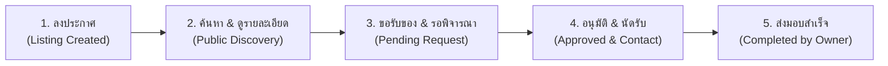
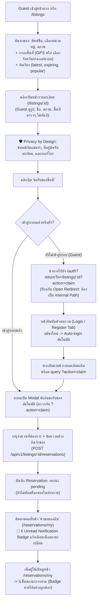
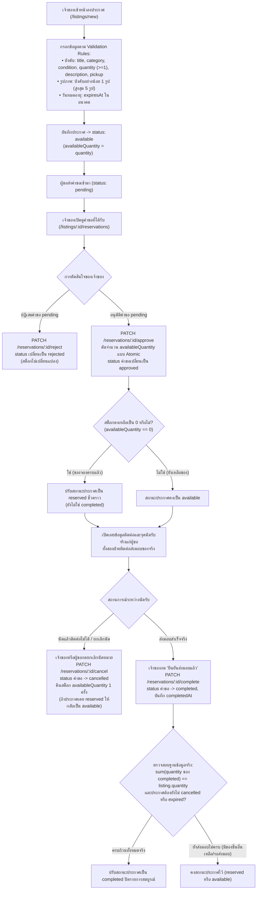
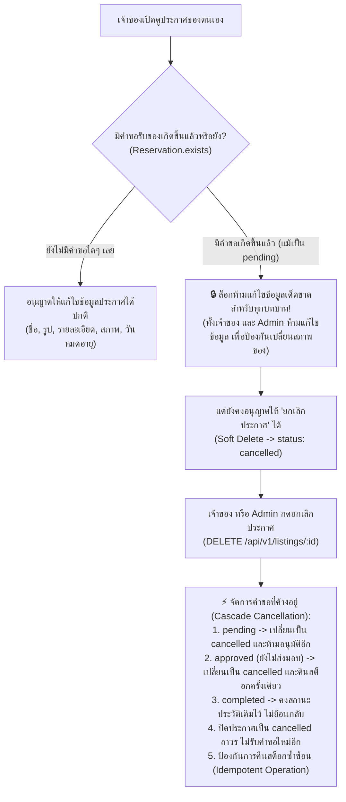
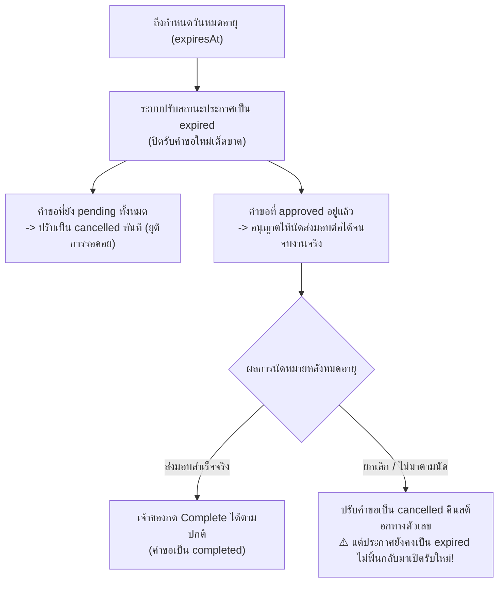
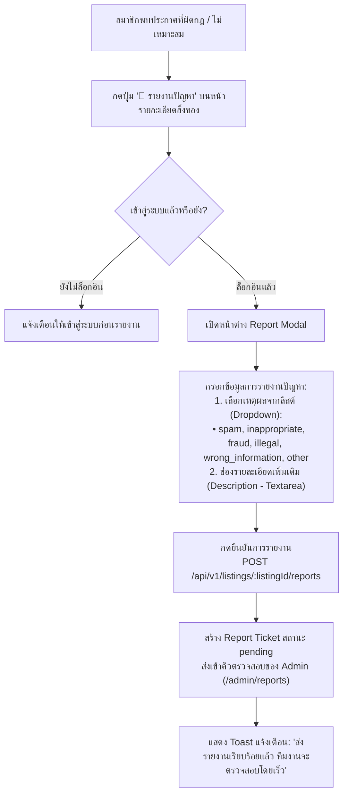

# Sharing Leftovers — User Workflow & System Journey (User Flow)

เอกสารสรุปขั้นตอนการทำงาน ลำดับการใช้งาน (User Flow) และเงื่อนไขทางเทคนิคสำหรับ **ผู้ใช้งานทั่วไปและสมาชิก (User Journey)** ตามข้อกำหนดระบบ Sharing Leftovers ฉบับสมบูรณ์ พร้อมปรับปรุงแก้ไขตามเกณฑ์ความพร้อมพัฒนา (Production-Ready Spec: P0, P1, P2)

---

## 📌 ภาพรวมวงจรชีวิตการแบ่งปัน (Lifecycle Overview)



---

## 1. Flow ผู้ขอรับสิ่งของ (Requester Flow)
*(เริ่มจากผู้เข้าชมทั่วไป Guest → เข้าสู่ระบบ → ส่งคำขอ → ติดตามสถานะ)*



### รายละเอียดขั้นตอน:
1. **ค้นหาและเลือกดูสิ่งของ (Public Discovery & Fallback Filter):**
   * **Endpoint:** `GET /api/v1/listings` (Public Access สำหรับทุกคน)
   * **การค้นหาและตัวกรอง:** ค้นหาจากชื่อ (Text Search `search`), หมวดหมู่ (`category`), สภาพสิ่งของ (`condition`: `new`, `like_new`, `good`, `fair`, `poor`)
   * **ระบบตำแหน่งและตัวกรองพื้นที่:**
     * **กรณีเปิด GPS:** คำนวณระยะทางรอบตัวผ่านพิกัด `lat`, `lng` และรัศมี `radius` (เมตร)
     * **กรณีไม่ใช้ GPS (Fallback):** รองรับการค้นหาและกรองพื้นที่ด้วยตนเอง (Manual Location Filter) โดยเลือก **จังหวัด, อำเภอ, ตำบล**
   * **ตัวเลือกการเรียงลำดับ (Sorting Options):** รายการใหม่ล่าสุด (`sort=latest`), รายการใกล้หมดเวลา (`sort=expiring`), หรือยอดนิยม (`sort=popular`)
2. **การเปิดดูรายละเอียดและการคุ้มครองข้อมูลส่วนบุคคล (Privacy by Design):**
   * ผู้ใช้ทั่วไป (Guest) เปิดดูรายละเอียดสิ่งของ (`/listings/:id`) ได้อย่างอิสระโดยไม่ต้องเข้าสู่ระบบ
   * **ข้อมูลที่ Guest มองเห็นได้:** รูปภาพสิ่งของ, ชื่อ, หมวดหมู่, สภาพ, จำนวนคงเหลือ, รายละเอียดสิ่งของ, **พื้นที่ระดับอำเภอ/ตำบล หรือระยะทางโดยประมาณ**
   * **ข้อมูลที่ถูกปิดบัง (Masked):** **พิกัดแม่นยำ (lat/lng), ที่อยู่นัดรับแบบละเอียด (บ้านเลขที่/ซอย/สถานที่เฉพาะเจาะจง), และเบอร์โทรศัพท์** จะถูกปิดบังไว้ ไม่แสดงแก่ Guest หรือผู้ใช้ทั่วไป
   * ข้อมูลติดต่อและจุดนัดรับจริงจะเปิดเผยเฉพาะผู้ขอที่ได้รับการอนุมัติ (`status: "approved"`) แล้วเท่านั้น
3. **กดขอรับสิ่งของและการกลับมาทำรายการต่อ (Frictionless Auth & Safe ReturnTo):**
   * เมื่อคลิกปุ่ม **"ขอรับของชิ้นนี้"**:
     * หากเข้าสู่ระบบแล้ว $\rightarrow$ เปิดฟอร์มขอรับของทันที
     * หากเป็น Guest $\rightarrow$ นำทางไปยัง `/auth?returnTo=/listings/:id?action=claim`
   * **ความปลอดภัยของ `returnTo`:** ระบบตรวจสอบว่า `returnTo` ต้องเป็น Relative Path ภายในเว็บไซต์เท่านั้น (ขึ้นต้นด้วย `/` ห้ามเป็น URL ภายนอก เพื่อป้องกันช่องโหว่ Open Redirect)
   * **เปิดฟอร์มขอรับของต่อเนื่อง:** เมื่อ Login/Register สำเร็จ ระบบพากลับมายัง `/listings/:id?action=claim` โค้ดหน้าบ้านจะตรวจจับ parameter `action=claim` และเปิด Modal ฟอร์มขอรับของขึ้นมาให้ทันทีโดยที่ผู้ใช้ไม่ต้องกดซ้ำ
4. **ส่งคำขอรับของ:**
   * สมาชิกระบุจำนวนที่ต้องการรับ ($\le$ `availableQuantity`) และพิมพ์ข้อความถึงเจ้าของ
   * **กฎเหล็ก "หนึ่งคนขอรับได้ครั้งเดียวต่อประกาศ" (Single Lifetime Reservation per Listing):**
     * ผู้ใช้ 1 คนส่งคำขอได้เพียง 1 ครั้งต่อประกาศตลอดอายุประกาศ แม้คำขอเดิมจะถูกปฏิเสธ (`rejected`) หรือยกเลิก (`cancelled`) ไปแล้วก็ตาม (บังคับด้วย Unique Compound Index `{ listing: 1, requester: 1 }` ใน MongoDB)
     * หากผู้ใช้เคยส่งคำขอในประกาศนี้แล้ว ปุ่ม *"ขอรับของชิ้นนี้"* บนหน้า `/listings/:id` จะถูก Disable พร้อมแสดงข้อความเตือนว่า *"คุณเคยส่งคำขอสำหรับสิ่งของชิ้นนี้ไปแล้ว"* พร้อมลิงก์ไปหน้า `/reservations/my`
   * เรียก API: `POST /api/v1/listings/:id/reservations`
   * สถานะคำขอบันทึกเป็น **`pending`** (ยังไม่ตัดสต็อกของในประกาศ)
5. **การติดตามผลและการแจ้งเตือน (Centralized Tracking & Read Status Management):**
   * ใช้หน้า **"คำขอของฉัน" (`/reservations/my`)** เป็นศูนย์กลางในการตรวจสอบสถานะคำขอทั้งหมด
   * **กลไก Notification Badge & การนับสถานะการอ่าน:**
     * ในโมเดล `Reservation` มีฟิลด์ `isReadByRequester: { type: Boolean, default: false }`
     * เมื่อเจ้าของอนุมัติ (`approved`) หรือปฏิเสธ (`rejected`) ฟิลด์นี้จะถูกรีเซ็ตเป็น `false`
     * แถบ Navbar แสดง **Notification Badge (จุดแดง/ตัวเลขคำขอที่ยังไม่อ่าน)** ดึงจากจำนวนคำขอที่ `isReadByRequester === false`
     * **การเคลียร์ Badge:** เมื่อผู้ใช้เปิดเข้ามาดูหน้า `/reservations/my` ระบบจะอัปเดตคำขอเหล่านั้นเป็น `isReadByRequester = true` ทำให้ Badge หายไปอย่างถูกต้องและแม่นยำ
6. **ศูนย์รวมแดชบอร์ดสมาชิก (Member Space Navigation):**
   * หน้าแดชบอร์ด / พื้นที่ของฉัน (`/dashboard`) เป็นศูนย์กลางที่สมาชิกใช้สลับดู 2 บทบาทในบัญชีเดียว:
     * **แท็บ "คำขอของฉัน" (`/reservations/my`):** ติดตามสถานะของที่ตนเองขอรับ (`pending`, `approved`, `completed`) พร้อมจุดแจ้งเตือน Unread Badge
     * **แท็บ "ประกาศของฉัน" (`/users/me/listings`):** ดูสถานะของที่ตนเองลงแจก, จำนวนคงเหลือ, และเปิดดูคำขอที่ได้รับ
7. **การจัดการโปรไฟล์และความปลอดภัย (Profile & Security Flow):**
   * **ดูและแก้ไขข้อมูลส่วนตัว (`GET / PATCH /api/v1/users/me`):**
     * สมาชิกเปิดหน้า "โปรไฟล์ของฉัน" เพื่อดูข้อมูลตนเอง
     * สามารถแก้ไข: ชื่อที่แสดง (`name`), เบอร์โทรศัพท์ติดต่อ (`phone`), และที่อยู่ประจำตัว (`address`: ตำบล/อำเภอ/จังหวัด, `location`: พิกัด)
     * *(อีเมลถูกล็อกห้ามแก้ไข เพื่อความมั่นคงปลอดภัยของบัญชี)*
   * **เปลี่ยนรหัสผ่าน (`PATCH /api/v1/auth/password`):**
     * สมาชิกต้องกรอก: "รหัสผ่านปัจจุบัน" (`currentPassword`) และ "รหัสผ่านใหม่" (`newPassword`: ความยาวขั้นต่ำ 8 ตัวอักษร)
     * ระบบตรวจสอบรหัสผ่านเดิม หากถูกต้องจะเข้ารหัส hash และบันทึกใหม่ทันที


---

## 2. Flow ผู้ให้ของ / เจ้าของประกาศ (Owner Flow)
*(ลงประกาศ → ตรวจสอบคำขอ → อนุมัติจอง → ส่งมอบ → ปิดประกาศ)*



### รายละเอียดขั้นตอน:
1. **ลงประกาศแบ่งปัน (`/listings/new`):**
   * **Validation Rules ที่เข้มงวด:**
     * **ฟิลด์บังคับ (Required Fields):**
       * ชื่อสิ่งของ (`title`)
       * หมวดหมู่สิ่งของ (`category`: ObjectId หรือ slug ที่มีอยู่จริง)
       * สภาพสิ่งของ (`condition`: `new`, `like_new`, `good`, `fair`, `poor`)
       * จำนวนสิ่งของ (`quantity`: จำนวนเต็ม $\ge 1$)
       * **รายละเอียดสิ่งของ (`description`):** บังคับกรอก เพื่อความชัดเจนและโปร่งใส
       * **วิธีและพื้นที่รับของ (`pickup` เท่านั้น):**
         * กำหนดวิธีรับของเป็น **นัดรับด้วยตนเอง (`pickup.method: "pickup"`) เท่านั้น** (ไม่มีตัวเลือกจัดส่งพัสดุ)
         * บังคับระบุพื้นที่รับของ (`pickup.address` / จังหวัด, อำเภอ, ตำบล และพิกัดหากมี) โดยข้อมูลนัดรับแบบละเอียด (บ้านเลขที่/ซอย/พิกัดแม่นยำ) จะถูก Masked และเปิดเผยให้เฉพาะผู้ขอที่ได้รับการอนุมัติคำขอแล้วเท่านั้น
     * **รูปภาพสิ่งของ (`images`):**
       * **ระยะ MVP:** รับข้อมูลเป็น **URL รูปภาพ** (Array of Strings) บังคับกรอกอย่างน้อย 1 รูป (`min: 1`) และสูงสุด 5 รูป (`max: 5`) โดยระบบตรวจสอบรูปแบบ URL (`http://` หรือ `https://`) ก่อนบันทึก เพื่อเตรียมความพร้อมสำหรับการเปลี่ยนเป็นระบบอัปโหลดไฟล์จริงในระยะถัดไปโดยไม่ต้องแก้ไขโครงสร้างข้อมูล
     * **วันหมดอายุประกาศ (`expiresAt`):** ต้องระบุวันที่ในอนาคตที่สมเหตุสมผล
   * เผยแพร่ประกาศ $\rightarrow$ สถานะประกาศเริ่มต้นเป็น **`available`** (`availableQuantity = quantity`)
2. **ตรวจสอบคำขอที่ได้รับ (`/listings/:id/reservations`):**
   * เจ้าของเปิดดูรายชื่อผู้ขอ, จำนวนที่ขอ, วันที่ขอ และข้อความ
   * จำนวนคงเหลือบนหน้าประกาศยังคงเท่าเดิม เพื่อให้เจ้าของพิจารณาได้อย่างอิสระ
3. **การจัดการคำขอและ State Transition Matrix:**
   * **กรณีปฏิเสธคำขอ `pending`:**
     * เจ้าของกดปุ่ม *"ปฏิเสธ"* $\rightarrow$ เรียก `PATCH /api/v1/reservations/:id/reject`
     * สถานะคำขอเปลี่ยนเป็น **`rejected`** (สต็อกไม่ลดลงและไม่มีการคืนสต็อก เพราะไม่เคยตัด)
   * **กรณีอนุมัติคำขอ `pending`:**
     * เจ้าของกดปุ่ม *"อนุมัติ"* $\rightarrow$ เรียก `PATCH /api/v1/reservations/:id/approve`
     * ระบบตรวจสอบสต็อกและ **ตัดจำนวนคงเหลือแบบ Atomic** (`availableQuantity` ลดลงตามจำนวนที่ขอ)
     * สถานะคำขอเปลี่ยนเป็น **`approved`** บันทึก `approvedAt`
     * **กฎการเปลี่ยนสถานะของประกาศเมื่อสต็อกหมด:**
       * หากของถูกจองครบจนเหลือ 0 ชิ้น (`availableQuantity === 0`) ประกาศจะเปลี่ยนสถานะเป็น **`reserved` (จองเต็มแล้ว)** ชั่วคราว **(ยังไม่ใช่ `completed`)** เพื่อรอการส่งมอบจริง
   * **กรณียกเลิกคำขอหลังอนุมัติแล้ว (Cancel After Approved):**
     * เจ้าของหรือผู้ขอกดยกเลิกนัดหมาย $\rightarrow$ เรียก `PATCH /api/v1/reservations/:id/cancel`
     * สถานะคำขอเปลี่ยนเป็น **`cancelled`** บันทึก `cancelledAt`
     * ระบบคืนสต็อก (`availableQuantity += reservation.quantity`) **เพียงครั้งเดียว (Idempotent)**
     * **เงื่อนไขฟื้นสถานะประกาศ:** หากประกาศมีสถานะเป็น `reserved` ให้ปรับกลับมาเป็น `available` **(แต่หากประกาศถูก Admin สั่ง `cancelled`, `expired` หรือ `completed` ไปแล้ว ห้ามเปลี่ยนกลับมาเป็น `available` เด็ดขาด!)**
4. **ยืนยันการส่งมอบเสร็จสิ้น (One-Party Completion & Strict Completed Criteria):**
   * เมื่อเจ้าของส่งมอบของจริงตรงหน้าเรียบร้อย เจ้าของกดปุ่ม **"ยืนยันส่งมอบแล้ว"** $\rightarrow$ เรียก `PATCH /api/v1/reservations/:id/complete`
   * สถานะคำขอนั้นเปลี่ยนเป็น **`completed`** บันทึก `completedAt` ทันที (ฝ่ายเดียวจบงาน ไม่ต้องรอผู้รับกดยืนยัน)
   * **กติกาการเปลี่ยนสถานะประกาศเป็น `completed`:**
     * ประกาศจะเปลี่ยนสถานะเป็น **`completed`** ได้ก็ต่อเมื่อ:
       1. ประกาศปัจจุบันต้องไม่อยู่ในสถานะ `cancelled` หรือ `expired`
       2. ผลรวมของจำนวนในคำขอที่ส่งมอบสำเร็จจริง (`status === "completed"`) เท่ากับจำนวนทั้งหมดของประกาศ (`listing.quantity`)
          $$\sum_{\text{Reservation.status === 'completed'}} \text{reservation.quantity} = \text{listing.quantity}$$
     * **กรณีทดสอบของหลายชิ้น:** เช่น มีของ 3 ชิ้น ผู้รับ 2 คนรับไปแล้วคนละ 1 ชิ้น (`completed` รวม 2 ชิ้น) ยังเหลือ 1 ชิ้น ระบบต้องคงสถานะประกาศไว้ ไม่ปิดเป็น `completed` จนกว่าชิ้นที่ 3 จะส่งมอบจริงสำเร็จ

---

## 3. Flow การแก้ไขและยกเลิกประกาศ (Edit & Cancel Policy)
*(กฎเหล็กความโปร่งใสและกติกากลืนคำขอ Cascade Cancellation)*



### รายละเอียดกฎเหล็ก:
1. **กฎการล็อกการแก้ไข (Strict Edit Lock for ALL Roles):**
   * เมื่อประกาศมีคำขอรับของเกิดขึ้นในระบบแล้ว (แม้จะมีเพียง 1 คำขอ และอยู่ในสถานะ `pending`) **ระบบจะล็อกห้ามแก้ไขข้อมูลประกาศโดยเด็ดขาดสำหรับทุกบทบาท (รวมถึง Admin)**
   * เพื่อป้องกันการแอบเปลี่ยนสภาพ จำนวน รูปภาพ หรือเงื่อนไขหลังมีคนส่งความจำนงขอรับของ
   * หากประกาศมีข้อผิดพลาดหรือผิดกฎ ให้ใช้การ **"ยกเลิกประกาศ" (Cancel Listing)** แทนเท่านั้น
2. **กติกาการจัดการคำขอเมื่อประกาศถูกยกเลิก (Cascade Cancellation & Idempotency):**
   * เมื่อประกาศถูกกดยกเลิก (ไม่ว่าจะกระทำโดย **เจ้าของประกาศ** หรือโดย **Admin**):
     * **คำขอที่ยัง `pending`:** ปิดคำขอโดยเปลี่ยนสถานะเป็น **`cancelled`** และไม่อนุญาตให้เจ้าของกดอนุมัติได้อีก
     * **คำขอที่ `approved` (ที่ยังไม่ได้ส่งมอบ):** เปลี่ยนสถานะเป็น **`cancelled`** และ **คืนสต็อกที่กันไว้กลับเข้าประกาศเพียงครั้งเดียว**
     * **คำขอที่ `completed`:** **คงสถานะเดิมไว้** เพื่อเก็บเป็นประวัติการรับ-ส่งมอบของที่เกิดขึ้นจริง ไม่ย้อนกลับ
     * **ประกาศที่ `cancelled`:** เปลี่ยนสถานะเป็น **`cancelled`** (Soft Delete) และ **ไม่รับคำขอใหม่เด็ดขาด**
     * **การป้องกันการคืนสต็อกซ้ำซ้อน (Idempotent Operation):** ดำเนินการตรวจสอบสถานะก่อนคืนสต็อก เพื่อป้องกัน Race Condition จากการกดยกเลิกซ้ำ

---

## 4. Flow การหมดอายุและการจัดการคำขอที่ค้างอยู่ (Expiry Policy)



1. **การหมดอายุของประกาศ (`status: "expired"`):**
   * เมื่อเวลาปัจจุบันเลยกำหนด `expiresAt` ระบบจะปรับสถานะประกาศเป็น **`expired`** ปิดการรับคำขอใหม่
2. **ผลต่อคำขอที่ยัง `pending`:**
   * คำขอที่ยังรอการอนุมัติอยู่จะถูก **Auto-cancel** ปรับเป็น `cancelled` ทันที เพื่อไม่ให้คำขอค้างคา และไม่อนุญาตให้เจ้าของกดอนุมัติย้อนหลัง
3. **ผลต่อคำขอที่ `approved` แล้ว:**
   * คำขอที่ได้รับการอนุมัติและนัดรับกันไว้แล้ว **ยังคงอนุญาตให้ดำเนินกระบวนการส่งมอบต่อได้จนจบ**
   * หากส่งมอบสำเร็จ เจ้าของกด Complete ได้ตามปกติ
   * หากการนัดหมายล้มเหลว คำขอจะถูกปรับเป็น `cancelled` มีการคืนสต็อกทางตัวเลข แต่ **ประกาศจะยังคงสถานะ `expired` ถาวร ไม่ถูกชุบชีวิตกลับมาเปิดรับใหม่**

---

## 5. Flow การรายงานปัญหาประกาศ (Report Listing Flow)
*(สำหรับสมาชิกแจ้งเบาะแสสิ่งผิดกฎหมายหรือไม่เหมาะสม)*



* **API Endpoint ที่ใช้งาน:** `POST /api/v1/listings/:listingId/reports`
* **Path Parameter:** `:listingId` (ระบุประกาศที่รายงาน)
* **Request Body:**
  ```json
  {
    "reason": "illegal",
    "description": "พบสิ่งของต้องห้ามหรืออันตรายตามกฎหมาย"
  }
  ```
* **เหตุผลตาม Enum ในระบบ:** `spam`, `inappropriate`, `fraud`, `illegal`, `wrong_information`, `other`

---

## 6. ตารางสรุปการเปลี่ยนสถานะของระบบ (State Transition & Stock Matrix)

| สถานะปัจจุบันของคำขอ | ผู้กระทำ / เหตุการณ์ | Action / API Endpoint | สถานะใหม่ของคำขอ | ผลต่อสถานะประกาศ (`Listing.status`) | ผลต่อสต็อก (`availableQuantity`) |
| :---: | :--- | :--- | :---: | :---: | :--- |
| — | ผู้ขอส่งคำขอ | `POST /listings/:id/reservations` | `pending` | คงเดิม (`available`) | **ไม่ตัดสต็อก** (เท่าเดิม) |
| `pending` | เจ้าของปฏิเสธ | `PATCH /reservations/:id/reject` | `rejected` | คงเดิม (`available`) | ไม่เปลี่ยนแปลง |
| `pending` | ผู้ขอยกเลิก | `PATCH /reservations/:id/cancel` | `cancelled` | คงเดิม (`available`) | ไม่เปลี่ยนแปลง |
| `pending` | ประกาศหมดอายุ | ระบบตรวจพบ `expiresAt` | `cancelled` | เปลี่ยนเป็น `expired` | ไม่เปลี่ยนแปลง |
| `pending` | เจ้าของอนุมัติ | `PATCH /reservations/:id/approve` | `approved` | ถ้าสต็อกเหลือ 0 $\rightarrow$ `reserved`<br>ถ้ายังเหลือ $\rightarrow$ `available` | **หักลดลงทันที (Atomic)** |
| `approved` | ผู้ขอยกเลิกนัด | `PATCH /reservations/:id/cancel` | `cancelled` | ถ้าเคย `reserved` $\rightarrow$ คืนเป็น `available`<br>*(ถ้า `cancelled/expired` คงเดิม)* | **คืนสต็อก 1 ครั้ง (Idempotent)** |
| `approved` | เจ้าของยกเลิกนัด | `PATCH /reservations/:id/cancel` | `cancelled` | ถ้าเคย `reserved` $\rightarrow$ คืนเป็น `available`<br>*(ถ้า `cancelled/expired` คงเดิม)* | **คืนสต็อก 1 ครั้ง (Idempotent)** |
| `approved` | เจ้าของยืนยันส่งมอบ | `PATCH /reservations/:id/complete` | `completed` | เป็น `completed` ก็ต่อเมื่อ<br>$\sum \text{completed} = \text{listing.quantity}$ | ไม่คืนสต็อก (ส่งมอบสำเร็จ) |
| Any | ประกาศถูกยกเลิก | `DELETE /listings/:id` | • `pending` $\rightarrow$ `cancelled`<br>• `approved` $\rightarrow$ `cancelled`<br>• `completed` $\rightarrow$ คงเดิม | **`cancelled`** (ปิดถาวร) | คืนสต็อกเฉพาะคำขอที่เคย `approved` เพียงครั้งเดียว |

---

## 7. โครงสร้างหน้าจอและสิทธิ์ที่เกี่ยวข้อง (Sitemap Integration)

```text
Sharing Leftovers
│
├── 1. หน้าสาธารณะ (Public & Guest)
│   ├── หน้าแรก (/)
│   ├── ค้นหาและดูรายการสิ่งของ (/listings)  <-- ค้นหาชื่อ, หมวดหมู่, สภาพ, GPS, กรองจังหวัด/อำเภอ/ตำบล, จัดเรียง
│   ├── หน้ารายละเอียดสิ่งของ (/listings/:id) <-- Guest ดูได้ (Mask พิกัดแม่นยำ/ที่อยู่ละเอียด/เบอร์โทร) + ปุ่มแจ้งรายงาน
│   └── หน้าเข้าสู่ระบบและสมัครสมาชิก (/auth) <-- รวม Login & Register, สมัครเสร็จ Auto-login ทันที
│
├── 2. พื้นที่สมาชิก (Member Space)
│   ├── แดชบอร์ด / พื้นที่ของฉัน (/dashboard)
│   │   ├── ข้อมูลโปรไฟล์ตนเอง (/users/me)
│   │   ├── ประกาศของฉัน (/users/me/listings)
│   │   ├── คำขอรับของของฉัน (/reservations/my)  <-- ศูนย์กลางติดตามสถานะ + Unread Notification Badges
│   │   └── เปลี่ยนรหัสผ่าน (/auth/password)
│   ├── ลงประกาศใหม่ (/listings/new)           <-- Form Validation บังคับรูป 1-5 รูป, บังคับรายละเอียด
│   ├── แก้ไขประกาศ (/listings/:id/edit)        <-- ล็อกห้ามแก้ไขเด็ดขาดสำหรับทุกบทบาทเมื่อมีคำขอแล้ว
│   └── จัดการคำขอที่ได้รับในประกาศ (/listings/:id/reservations)
│
└── 3. พื้นที่ผู้ดูแลระบบ (Admin Space - เฉพาะ role: "admin")
    ├── หน้าภาพรวมผู้ดูแลระบบ (/admin)
    ├── ตารางจัดการประกาศทั้งหมด (/admin/listings) <-- ค้นหา กรอง และจัดการประกาศผิดกฎจากหลังบ้าน
    ├── จัดการสมาชิกในชุมชน (/admin/users)
    ├── จัดการหมวดหมู่สิ่งของ (/admin/categories)
    └── ตรวจสอบรายงานปัญหา (/admin/reports)
```