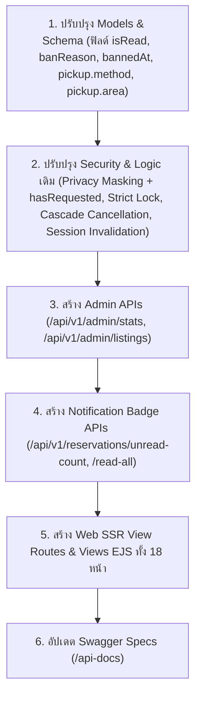

# รายการ API และ Logic ที่ต้องพัฒนาเพิ่มเติมสำหรับ Sharing Leftovers
> อ้างอิงการเปรียบเทียบจาก: โค้ดโปรเจกต์ปัจจุบัน (`src/`) เทียบกับ `plan.md`, `userFlow.md`, `adminFlow.md`, และ `requirement.md`  
> วันที่จัดทำ: 13 ตุลาคม 2026

---

## 1. บทสรุปสถานะปัจจุบัน (Current Codebase vs Specs)

จากการตรวจสอบไฟล์โค้ดจริงในโฟลเดอร์ `src/` (ได้แก่ `routes/`, `controllers/`, และ `models/`) เทียบกับข้อกำหนดล่าสุดในเอกสารสเปก พบว่า:
1. **ระบบมีโครงสร้างพื้นฐานที่ดีแล้ว:** มีระบบ Auth (Session + MongoStore), CRUD พื้นฐานของ Categories, Listings, Reservations และ Reports พร้อม Swagger API Docs
2. **ยังขาด API สำหรับงาน Admin และ Notification:** ยังไม่มี Endpoint สรุปสถิติภาพรวม Admin Dashboard (`/admin/stats`), ยังไม่มี Endpoint สำหรับให้แอดมินกำกับดูแลประกาศ (`/admin/listings`), และไม่มี Endpoint รองรับ Badge แจ้งเตือนสถานะคำขอรับของ (`/reservations/unread-count`)
3. **API เดิมยังขาด Business Rules & ข้อมูลสนับสนุน UI ล่าสุด:**
   - ยังไม่มี **Privacy by Design Masking** และ **Flag ตรวจสอบสถานะคำขอเดิม (`hasRequested`)** ใน `GET /listings/:id`
   - ยังไม่มี **Strict Edit Lock** ใน `PATCH /listings/:id` (ปัจจุบันยอมให้แก้ประกาศแม้มีคนขอรับของแล้ว)
   - ยังไม่มี **Cascade Cancellation** ใน `DELETE /listings/:id` (ปัจจุบันเปลี่ยนแค่สถานะประกาศ แต่ไม่ได้อัปเดตคำขอที่ค้างอยู่)
   - ยังไม่มี **Immediate Session Invalidation** และ **การบันทึกเหตุผลการระงับ (`banReason`, `bannedAt`)** ใน `PATCH /users/:id/status`
   - ยังไม่มี **Fallback กรองพื้นที่ด้วยตนเอง** (จังหวัด, อำเภอ, ตำบล) ใน `GET /listings`
   - ยังไม่มี **`pendingCount`** ใน `GET /users/me/listings` (สำหรับแสดงชิปตัวเลขนับคำขอรอพิจารณาในหน้าประกาศของฉัน)
   - ยังไม่มี **`usageCount`** ใน `GET /categories` (สำหรับแสดงจำนวนประกาศที่ใช้หมวดหมู่นี้ในหน้าจัดการหมวดหมู่ของ Admin)

---

## 2. กลุ่มที่ 1: รายการ API ใหม่ที่ต้องสร้างเพิ่ม (New APIs to Add)

### 2.1 โมดูลกำกับดูแลประกาศสำหรับผู้ดูแลระบบ (Admin Listings API)
> รองรับ: FR-12, FR-13, PlanUI Phase 8 และ AdminFlow ขั้นที่ 4–5

| Method | Endpoint | สิทธิ์การเข้าถึง | วัตถุประสงค์และการทำงาน |
|---|---|:---:|---|
| `GET` | `/api/v1/admin/listings` | **Admin Only** | **ดึงรายการประกาศทั้งหมดในระบบสำหรับ Back-Office:** • รองรับ Pagination (`page`, `limit`) • กรองสถานะประกาศ (`status: all, available, reserved, completed, cancelled, expired`) • กรองตามหมวดหมู่ (`category`) • ค้นหาด้วยชื่อประกาศหรือชื่อผู้ลงประกาศ (`search`) • Populate ข้อมูลผู้ลงประกาศ (`owner`) และนับจำนวนรายงานปัญหา (`reportCount`) |
| `PATCH` | `/api/v1/admin/listings/:id/status` | **Admin Only** | **แอดมินสั่งระงับหรือยกเลิกประกาศที่มีปัญหา:** • รับค่า `{ status: "cancelled", reason: string }` • บันทึกประวัติการระงับประกาศ • **ทริกเกอร์ Cascade Cancellation ทันที:** สั่งยกเลิกคำขอที่ค้างอยู่ทั้งหมด (ทั้ง `pending` และ `approved`) เป็น `"cancelled"` พร้อมคืนสต็อก |

---

### 2.2 โมดูลระบบแจ้งเตือนและ Badge สถานะคำขอ (Reservation Notification Badge API)
> รองรับ: FR-11, PlanUI Phase 3 & 5, UserFlow ขั้นที่ 5, และ Sitemap

| Method | Endpoint | สิทธิ์การเข้าถึง | วัตถุประสงค์และการทำงาน |
|---|---|:---:|---|
| `GET` | `/api/v1/reservations/unread-count` | **Logged-in User** | **ดึงจำนวนคำขอที่มีการเปลี่ยนสถานะที่ยังไม่ได้เปิดดู:** • ตรวจสอบคำขอของผู้ใช้ (`requester = user._id`) ที่มี `isRead: false` และสถานะเปลี่ยนไปจากเดิม (`approved`, `rejected`, `cancelled`) • คืนค่า `{ success: true, unreadCount: number }` • ใช้แสดงผล Badge สีแดงบนเมนูนำทาง (Navigation Bar) |
| `PATCH` | `/api/v1/reservations/:id/read` | **Logged-in User** | **ทำเครื่องหมายคำขอว่าเปิดอ่านแล้ว:** • อัปเดต `isRead: true` สำหรับคำขอดังกล่าว เพื่อเคลียร์ Badge แจ้งเตือน |
| `PATCH` | `/api/v1/reservations/read-all` | **Logged-in User** | **ทำเครื่องหมายคำขอทั้งหมดว่าอ่านแล้ว:** • อัปเดต `isRead: true` ให้ทุกคำขอของผู้ใช้รายนั้นพร้อมกัน เมื่อผู้ใช้กดเข้ามายังหน้า `/reservations/my` |

---

### 2.3 โมดูลสรุปสถิติแผงควบคุมระบบสำหรับผู้ดูแลระบบ (Admin Dashboard Stats API)
> รองรับ: PlanUI Phase 8, AdminFlow

| Method | Endpoint | สิทธิ์การเข้าถึง | วัตถุประสงค์และการทำงาน |
|---|---|:---:|---|
| `GET` | `/api/v1/admin/stats` | **Admin Only** | **ดึงตัวเลขสถิติภาพรวมสำหรับ Dashboard หลังบ้าน:** • คืนค่า `{ success: true, data: { totalUsers: number, suspendedUsers: number, activeListings: number, pendingReports: number } }` • ใช้แสดงผลบนการ์ดสถิติ 4 ใบในหน้าแรกของ `/admin` โดยไม่ต้องเขียน query ซ้ำซ้อน |

---

### 2.4 โมดูลเส้นทางหน้าเว็บ (Web SSR Routes ใน `src/routes/web.routes.js` หรือ `app.js`)
> รองรับ: Architecture Plan, PlanUI Phase 0–10, UserFlow, และ AdminFlow

ปัจจุบันใน `src/app.js` มีเพียง `app.get("/", ...)` และ `app.get("/health", ...)` เท่านั้น จำเป็นต้องเพิ่ม Route สำหรับแสดงผลหน้า EJS ให้ครอบคลุมทุกหน้าตาม Sitemap และ PlanUI ดังนี้:

| Method | Path | การป้องกัน / สิทธิ์ | วัตถุประสงค์และหน้าที่ของ View Template |
|---|---|:---:|---|
| `GET` | `/` | Public | หน้าแรก (Hero, หมวดหมู่, สิ่งของเพิ่งแบ่งปัน 6-8 ชิ้น, วิธีใช้งาน) |
| `GET` | `/auth` | Public (ถ้า Login แล้ว Redirect ไป `/`) | หน้าเข้าสู่ระบบและสมัครสมาชิกแบบหน้าเดียว (Unified Auth) พร้อมรองรับ `?returnTo=...` |
| `GET` | `/listings` | Public | หน้าค้นหาและกรองสิ่งของ (รัศมี GPS / เลือกพื้นที่เอง / ค้นหาชื่อ / หมวดหมู่) |
| `GET` | `/listings/:id` | Public | หน้ารายละเอียดประกาศสำหรับผู้ใช้งานทั่วไป (พร้อม Privacy Masking และปุ่มขอรับของ) |
| `GET` | `/listings/new` (หรือ `/create`) | Require Auth | หน้าแบบฟอร์มลงประกาศแบ่งปันสิ่งของใหม่ (ข้อมูล, รูปภาพ 1-5 รูป, นัดรับเท่านั้น) |
| `GET` | `/listings/:id/edit` | Require Auth + Owner | หน้าแบบฟอร์มแก้ไขประกาศ (หากมีคำขอเกิดขึ้นแล้วจะล็อกห้ามแก้ แสดงข้อความชี้แจง) |
| `GET` | `/listings/:id/reservations` | Require Auth + Owner | หน้าศูนย์จัดการคำขอของประกาศนั้นๆ (อนุมัติ, ปฏิเสธ, ยืนยันส่งมอบ) |
| `GET` | `/dashboard` | Require Auth | หน้าศูนย์รวมกิจกรรมของสมาชิก (แท็บคำขอของฉัน / ประกาศของฉัน / สรุปสถิติตนเอง) |
| `GET` | `/reservations/my` | Require Auth | หน้าเว็บศูนย์กลางติดตามคำขอรับของของผู้ใช้ พร้อมตารางสถานะและเคลียร์ Badge |
| `GET` | `/users/me/listings` | Require Auth | หน้าประวัติประกาศของตนเอง พร้อมชิปแสดงจำนวนคำขอที่รอพิจารณา (`pendingCount`) |
| `GET` | `/users/me` | Require Auth | หน้าดูและแก้ไขข้อมูลโปรไฟล์ตนเอง |
| `GET` | `/auth/password` | Require Auth | หน้าเปลี่ยนรหัสผ่านของสมาชิก |
| `GET` | `/admin` | Require Auth + Require Admin | หน้าแผงควบคุมหลักของผู้ดูแลระบบ พร้อมการ์ดสถิติ 4 ใบและรายงานล่าสุด |
| `GET` | `/admin/listings` | Require Auth + Require Admin | หน้าตารางกำกับดูแลประกาศทั้งหมดในระบบ พร้อมปุ่มยกเลิกประกาศ |
| `GET` | `/admin/reports` | Require Auth + Require Admin | หน้าตรวจสอบและจัดการตั๋วรายงานปัญหา |
| `GET` | `/admin/users` | Require Auth + Require Admin | หน้าจัดการสมาชิก และ Modal ยืนยันระงับ/ปลดระงับบัญชี (ห้ามแก้ role) |
| `GET` | `/admin/categories` | Require Auth + Require Admin | หน้าจัดการหมวดหมู่สิ่งของ พร้อมแสดงตัวเลขจำนวนประกาศที่ใช้หมวดหมู่ |
| `GET` | `/help/how-it-works` | Public | หน้าช่วยเหลือ อธิบายกติกา 5 ขั้นตอน และคำถามที่พบบ่อย (FAQ) |

---

## 3. กลุ่มที่ 2: รายการ API เดิมที่ต้องปรับปรุง Logic และ Validation (Existing APIs Enhancement)

รายการด้านล่างนี้มี Route อยู่ในโปรเจกต์แล้ว แต่จำเป็นต้องปรับปรุง Logic ใน Controller / Middleware ให้ตรงตามกฎล่าสุด:

### 3.1 ประกาศแบ่งปันสิ่งของ (Listings Module)

#### 1. `GET /api/v1/listings` (ค้นหาและกรองประกาศ)
- **สถานะในโค้ดปัจจุบัน:** รองรับ `lat`, `lng`, `radius`, `search`, `category`, `condition`, `status`, `sort`
- **สิ่งที่ต้องเพิ่ม/ปรับปรุง (FR-03 & UserFlow ข้อ 2):**
  - **Manual Regional Fallback:** เพิ่ม Query Parameters `province`, `district`, `subdistrict` สำหรับผู้ใช้ที่ไม่อนุญาตการเข้าถึง GPS เพื่อกรองตามเขตพื้นที่รับของ
  - **Sorting Presets:** ตรวจสอบความถูกต้องของ Sort (`latest` [ค่าเริ่มต้น], `expiring` [ใกล้หมดอายุ `expiresAt: 1`], `popular` [`viewCount: -1`], `oldest` [`createdAt: 1`])

#### 2. `GET /api/v1/listings/:id` (ดูรายละเอียดประกาศ)
- **สถานะในโค้ดปัจจุบัน:** คืนค่า Object ประกาศพร้อมเบอร์โทรเจ้าของและพิกัดให้ทุกคน
- **สิ่งที่ต้องเพิ่ม/ปรับปรุง (FR-04, UserFlow ข้อ 1 - Privacy by Design & PlanUI Phase 2):**
  - ตรวจสอบสิทธิ์ของผู้ที่กำลังเรียก API:
    - **Guest / ผู้ใช้ทั่วไป:** ทำการ Masked ข้อมูลที่อยู่นัดรับละเอียด (`pickup.address`), พิกัดแม่นยำ (`pickup.location.coordinates`), และเบอร์โทรของเจ้าของ (`owner.phone`) โดยส่งกลับเฉพาะพื้นที่ระดับตำบล/อำเภอ/จังหวัด
    - **เจ้าของประกาศ หรือ ผู้ขอที่ได้รับการอนุมัติ (`approved`):** ส่งข้อมูลที่อยู่นัดรับ พิกัด และข้อมูลติดต่อฉบับเต็ม
  - **Single Request State / Flag ตรวจสอบคำขอเดิม (`hasRequested`):**
    - หากมีผู้ใช้ล็อกอินอยู่ ให้ตรวจสอบ `Reservation.findOne({ listing: id, requester: req.user.id })`
    - คืนค่า `hasRequested: boolean` (และ `myReservation: { _id, status }` หากมี) เพื่อให้ UI หน้ารายละเอียดปิดปุ่ม "ขอรับของ" ทันที และแสดงข้อความเตือน *"คุณเคยส่งคำขอสำหรับสิ่งของชิ้นนี้ไปแล้ว"* พร้อมลิงก์ไป `/reservations/my` โดยไม่ต้องรอให้ผู้ใช้กดยื่นคำขอแล้วเจอ Error 409

#### 3. `POST /api/v1/listings` (สร้างประกาศใหม่)
- **สถานะในโค้ดปัจจุบัน:** ตรวจสอบเพียง `title`, `category`, `condition`, `quantity`
- **สิ่งที่ต้องเพิ่ม/ปรับปรุง (FR-05, UserFlow ข้อ 3):**
  - บังคับ `description` ต้อง Required และมีความยาวเหมาะสม (ไม่เป็นค่าว่าง)
  - บังคับ `images` ต้องเป็น Array ของ URL อย่างน้อย 1 รูป และไม่เกิน 5 รูป (1–5 รูปภาพ)
  - บังคับ `pickup.method` ต้องเป็น `"pickup"` เท่านั้น (Pickup Only ปฏิเสธ delivery)
  - บังคับข้อมูลที่อยู่นัดรับและเขตพื้นที่ (`pickup.address`, `pickup.area`)

#### 4. `PATCH /api/v1/listings/:id` (แก้ไขประกาศ)
- **สถานะในโค้ดปัจจุบัน:** เจ้าของหรือแอดมินแก้ไขได้ และยอมให้แก้ตราบใดที่ `quantity` ไม่น้อยกว่ายอดที่จองไปแล้ว
- **สิ่งที่ต้องเพิ่ม/ปรับปรุง (FR-06, UserFlow ข้อ 8, AdminFlow):**
  - **Strict Edit Lock (ล็อกห้ามทุกคนแก้ไขหลังมีคำขอแรก):** ตรวจสอบคำขอในประกาศด้วย `Reservation.exists({ listing: id })` หากมีคำขอเกิดขึ้นแล้วแม้แต่คำขอเดียว (ไม่ว่าสถานะใด) **ระบบจะล็อกห้ามทุกคนแก้ไขประกาศโดยเด็ดขาด** เจ้าของจะได้รับตอบกลับ `HTTP 409 Conflict` (หากต้องการเปลี่ยนแปลง ต้องกดยกเลิกประกาศเพื่อลงใหม่เท่านั้น)
  - **Admin Permission Isolation:** แอดมินไม่มีสิทธิ์แก้ไขเนื้อหาประกาศของผู้อื่นในทุกกรณี (ตอบกลับ `HTTP 403 Forbidden` เสมอ) แอดมินมีสิทธิ์เฉพาะระงับ/ยกเลิกประกาศเท่านั้น

#### 5. `DELETE /api/v1/listings/:id` (ยกเลิกประกาศ)
- **สถานะในโค้ดปัจจุบัน:** ปรับแค่ `status: "cancelled"` บน Listing
- **สิ่งที่ต้องเพิ่ม/ปรับปรุง (FR-07, UserFlow ข้อ 5, AdminFlow ข้อ 5):**
  - **Cascade Cancellation:** ต้องรัน Logic จัดการคำขอที่เกี่ยวข้องทั้งหมด:
    - คำขอสถานะ `pending` $\rightarrow$ ปรับเป็น `cancelled` (เนื่องจากประกาศถูกปิด) พร้อมตั้ง `isRead: false`
    - คำขอสถานะ `approved` $\rightarrow$ ปรับเป็น `cancelled` พร้อมคืนสต็อกเข้าคลังประกาศ 1 ครั้ง (`restoreQuantity`) และตั้ง `isRead: false`
    - คำขอสถานะ `completed` $\rightarrow$ คงสถานะไว้เป็นประวัติเดิม ห้ามแก้ไข

#### 6. `GET /api/v1/users/me/listings` (ประกาศของฉัน)
- **สถานะในโค้ดปัจจุบัน:** ส่งกลับเฉพาะรายการประกาศของตนเองตาม `owner: req.user.id`
- **สิ่งที่ต้องเพิ่ม/ปรับปรุง (PlanUI Phase 6):**
  - **Aggregate Pending Requests Count (`pendingCount`):** เพิ่มการนับจำนวนคำขอที่รอการพิจารณา (`status: "pending"`) สำหรับแต่ละประกาศ และส่งกลับฟิลด์ `pendingCount: number` มาพร้อมกับข้อมูลประกาศ เพื่อให้ UI หน้าประกาศของฉันแสดงชิปตัวเลขแจ้งเตือนคำขอที่รอการตัดสินใจได้อย่างถูกต้อง

---

### 3.2 การขอรับสิ่งของ (Reservations Module)

#### 1. `POST /api/v1/listings/:listingId/reservations` (ส่งคำขอรับของ)
- **สถานะในโค้ดปัจจุบัน:** มี Compound Unique Index บน DB แล้ว แต่ยังไม่มีข้อความแจ้งเตือนที่ชัดเจน
- **สิ่งที่ดัดแปลงเพิ่ม (FR-09, UserFlow ข้อ 6):**
  - ตรวจสอบ `Reservation.findOne({ listing: listingId, requester: req.user.id })` ก่อนสร้างคำขอ หากพบคำขอเดิม (แม้จะ `rejected` หรือ `cancelled` ไปแล้ว) ให้ตอบกลับ `HTTP 409 Conflict` พร้อมข้อความชัดเจน: *"คุณเคยส่งคำขอรับสิ่งของในประกาศนี้แล้ว ไม่สามารถส่งคำขอซ้ำได้"* (Single Lifetime Reservation)

#### 2. `PATCH /api/v1/reservations/:id/approve` (อนุมัติคำขอ)
- **สถานะในโค้ดปัจจุบัน:** อนุญาตให้ Admin อนุมัติแทนเจ้าของได้
- **สิ่งที่ต้องเพิ่ม/ปรับปรุง (FR-10, AdminFlow):**
  - **Admin Isolation:** จำกัดสิทธิ์ให้เฉพาะเจ้าของประกาศตัวจริงเท่านั้น (`listing.owner.toString() === req.user.id`) แอดมินไม่สามารถอนุมัติคำขอแทนได้
  - ปรับ `isRead: false` บน Reservation เพื่อให้ผู้ขอได้รับ Notification Badge

#### 3. `PATCH /api/v1/reservations/:id/reject` & `PATCH /api/v1/reservations/:id/cancel`
- **สิ่งที่ต้องเพิ่ม/ปรับปรุง:**
  - ปรับ `isRead: false` เมื่อสถานะถูกปฏิเสธ เพื่อแจ้งเตือนผู้ขอ
  - หากรายการที่ถูกปฏิเสธหรือยกเลิกเคยอยู่ในสถานะ `approved` ให้คืนสต็อกและปลดสถานะประกาศจาก `"reserved"` กลับมาเป็น `"available"` (โค้ดปัจจุบันมีส่วนนี้แล้ว ให้คงไว้และเพิ่ม `isRead`)

#### 4. `PATCH /api/v1/reservations/:id/complete` (ยืนยันส่งมอบ)
- **สถานะในโค้ดปัจจุบัน:** เช็คแค่ `if (listing.availableQuantity <= 0)` แล้วปรับประกาศเป็น `completed`
- **สิ่งที่ต้องเพิ่ม/ปรับปรุง (FR-10, UserFlow ข้อ 7):**
  - ประกาศจะเปลี่ยนสถานะเป็น `"completed"` ก็ต่อเมื่อ **ผลรวมจำนวนสิ่งของที่ส่งมอบสำเร็จครบถ้วนตามยอดประกาศทั้งหมดเท่านั้น** ($\sum_{\text{completed}} \text{quantity} = \text{listing.quantity}$)

---

### 3.3 การจัดการผู้ใช้งาน (Users Module)

#### 1. `PATCH /api/v1/users/:id/status` (Admin จัดการสถานะผู้ใช้)
- **สถานะในโค้ดปัจจุบัน:** อัปเดตเฉพาะฟิลด์ `isActive` และ `role` ในคอลเลกชัน `users`
- **สิ่งที่ต้องเพิ่ม/ปรับปรุง (FR-15, AdminFlow ข้อ 6 & PlanUI Phase 9):**
  - **No Privilege Escalation (ตัดฟิลด์ role):** บังคับให้รับเฉพาะ `isActive: boolean` และ `reason: string` สำหรับระบุเหตุผลเท่านั้น **ตัดการรับฟิลด์ `role` ทิ้งอย่างเด็ดขาด** แอดมินไม่มีสิทธิ์แต่งตั้งหรือเปลี่ยนสิทธิ์บทบาทผู้ใช้ผ่านระบบ (การตั้ง Admin ต้องทำตรงผ่านระดับ Database เท่านั้น)
  - **Immediate Session Invalidation:** เมื่อแอดมินส่งค่า `isActive: false` (ระงับบัญชีผู้ใช้) ระบบต้องลบ Session ทั้งหมดของผู้ใช้นั้นออกจาก MongoDB Store (`connect-mongo` คอลเลกชัน `sessions`) ทันที เพื่อตัดสิทธิ์การยิง API หรือเข้าถึงหน้าเว็บของผู้ใช้รายนั้นทันที
  - **Ban Reason & Timestamp Storage:** เมื่อสั่งระงับบัญชี ต้องบันทึกเหตุผล `reason` ลงในฟิลด์ `banReason: string` และบันทึกเวลา `bannedAt: Date` ลงใน Document ของโมเดล `User` เพื่อใช้แสดงผลและตรวจสอบย้อนหลัง

---

### 3.4 หมวดหมู่สิ่งของ (Categories Module)

#### 1. `GET /api/v1/categories` (ดึงรายการหมวดหมู่ทั้งหมด)
- **สถานะในโค้ดปัจจุบัน:** ส่งกลับเฉพาะรายการหมวดหมู่ `{ _id, name, slug, description, icon, isActive }`
- **สิ่งที่ต้องเพิ่ม/ปรับปรุง (PlanUI Phase 9):**
  - **Usage Count Aggregation (`usageCount`):** เพิ่มการนับจำนวนประกาศที่กำลังใช้งานหมวดหมู่นั้นๆ ส่งกลับมาเป็นฟิลด์ `usageCount: number` เพื่อนำไปแสดงในตารางหมวดหมู่ของ Admin (`/admin/categories`) และใช้ตรวจสอบแจ้งเตือนผู้ดูแลระบบก่อนปิดใช้งานหรือลบหมวดหมู่

---

## 4. ตารางสรุป Master API Matrix (ภาพรวมทั้งระบบ)

| ลำดับ | Method | Endpoint Path | สิทธิ์ | สถานะในโค้ดปัจจุบัน | สิ่งที่ต้องทำ |
|:---:|---|---|:---:|:---:|---|
| **1** | `POST` | `/api/v1/auth/register` | Public | มีแล้ว | รองรับ `returnTo` redirect |
| **2** | `POST` | `/api/v1/auth/login` | Public | มีแล้ว | รองรับ `returnTo` redirect |
| **3** | `GET` | `/api/v1/auth/me` | Logged-in | มีแล้ว | คงเดิม |
| **4** | `POST` | `/api/v1/auth/logout` | Logged-in | มีแล้ว | คงเดิม |
| **5** | `PATCH` | `/api/v1/auth/password` | Logged-in | มีแล้ว | คงเดิม |
| **6** | `GET` | `/api/v1/users/me` | Logged-in | มีแล้ว | คงเดิม |
| **7** | `PATCH` | `/api/v1/users/me` | Logged-in | มีแล้ว | คงเดิม |
| **8** | `DELETE`| `/api/v1/users/me` | Logged-in | มีแล้ว | คงเดิม |
| **9** | `GET` | `/api/v1/users/me/listings` | Logged-in | มีแล้ว | **ปรับแก้:** เพิ่ม Aggregate ฟิลด์ `pendingCount` นับคำขอรออนุมัติ |
| **10**| `GET` | `/api/v1/users` | Admin | มีแล้ว | คงเดิม |
| **11**| `GET` | `/api/v1/users/:id` | Admin | มีแล้ว | คงเดิม |
| **12**| `PATCH`| `/api/v1/users/:id/status` | Admin | มีแล้ว | **ปรับแก้:** Immediate Session Invalidation, บันทึก `banReason`/`bannedAt`, ตัดฟิลด์ role ทิ้ง |
| **13**| `GET` | `/api/v1/categories` | Public | มีแล้ว | **ปรับแก้:** เพิ่ม Aggregate ฟิลด์ `usageCount` นับจำนวนประกาศในแต่ละหมวด |
| **14**| `GET` | `/api/v1/categories/:id` | Public | มีแล้ว | คงเดิม |
| **15**| `POST` | `/api/v1/categories` | Admin | มีแล้ว | คงเดิม |
| **16**| `PATCH`| `/api/v1/categories/:id` | Admin | มีแล้ว | คงเดิม |
| **17**| `DELETE`| `/api/v1/categories/:id` | Admin | มีแล้ว | คงเดิม |
| **18**| `GET` | `/api/v1/listings` | Public | มีแล้ว | **ปรับแก้:** เพิ่ม Fallback กรองจังหวัด/อำเภอ/ตำบล |
| **19**| `POST` | `/api/v1/listings` | Logged-in | มีแล้ว | **ปรับแก้:** บังคับรูป 1-5 URLs, Pickup Only, description |
| **20**| `GET` | `/api/v1/listings/:id` | Public | มีแล้ว | **ปรับแก้:** Privacy Masking + ฟิลด์ `hasRequested` สำหรับ user ที่ล็อกอิน |
| **21**| `PATCH`| `/api/v1/listings/:id` | Owner Only | มีแล้ว | **ปรับแก้:** Strict Edit Lock & ตัดสิทธิ์ Admin แก้ไข |
| **22**| `DELETE`| `/api/v1/listings/:id` | Owner / Admin | มีแล้ว | **ปรับแก้:** เพิ่ม Cascade Cancellation จัดการคำขอคงค้าง |
| **23**| `POST` | `/api/v1/listings/:id/reservations` | Logged-in | มีแล้ว | **ปรับแก้:** ข้อความ Single Lifetime Reservation |
| **24**| `GET` | `/api/v1/listings/:id/reservations` | Owner / Admin | มีแล้ว | คงเดิม |
| **25**| `GET` | `/api/v1/reservations/my` | Logged-in | มีแล้ว | **ปรับแก้:** รองรับข้อมูล `isRead` และ Badge |
| **26**| `PATCH`| `/api/v1/reservations/:id/approve` | Owner Only | มีแล้ว | **ปรับแก้:** ตัดสิทธิ์ Admin & ตั้ง `isRead: false` |
| **27**| `PATCH`| `/api/v1/reservations/:id/reject` | Owner Only | มีแล้ว | **ปรับแก้:** ตั้ง `isRead: false` แจ้งเตือนผู้ขอ |
| **28**| `PATCH`| `/api/v1/reservations/:id/cancel` | Requester | มีแล้ว | คงเดิม |
| **29**| `PATCH`| `/api/v1/reservations/:id/complete` | Owner Only | มีแล้ว | **ปรับแก้:** ปิดประกาศ completed เมื่อผลรวมส่งมอบครบจริง |
| **30**| `POST` | `/api/v1/listings/:id/reports` | Logged-in | มีแล้ว | คงเดิม |
| **31**| `GET` | `/api/v1/reports` | Admin | มีแล้ว | คงเดิม |
| **32**| `GET` | `/api/v1/reports/:id` | Admin | มีแล้ว | คงเดิม |
| **33**| `PATCH`| `/api/v1/reports/:id` | Admin | มีแล้ว | คงเดิม |
| **34**| `GET` | `/api/v1/admin/stats` | Admin | **ยังไม่มี** | **สร้างใหม่:** ดึงตัวเลขสถิติภาพรวม 4 รายการสำหรับ Admin Dashboard |
| **35**| `GET` | `/api/v1/admin/listings` | Admin | **ยังไม่มี** | **สร้างใหม่:** ดึงรายการประกาศทั้งหมดในระบบสำหรับ Admin |
| **36**| `PATCH`| `/api/v1/admin/listings/:id/status`| Admin | **ยังไม่มี** | **สร้างใหม่:** สั่งระงับประกาศ + Cascade Cancellation |
| **37**| `GET` | `/api/v1/reservations/unread-count` | Logged-in | **ยังไม่มี** | **สร้างใหม่:** ดึงตัวเลขนับคำขอที่เปลี่ยนสถานะ (Badge) |
| **38**| `PATCH`| `/api/v1/reservations/:id/read` | Logged-in | **ยังไม่มี** | **สร้างใหม่:** มาร์กสถานะอ่านแล้วรายคำขอ |
| **39**| `PATCH`| `/api/v1/reservations/read-all` | Logged-in | **ยังไม่มี** | **สร้างใหม่:** มาร์กสถานะอ่านแล้วทั้งหมดเมื่อเข้าหน้าเว็บ |
| **40**| `GET` | `/` ... `/help/how-it-works` | หลายสิทธิ์ | **ยังไม่มี** | **สร้างใหม่:** ชุด Web SSR Routes 18 หน้าตามตารางข้อ 2.4 |

---

## 5. ลำดับขั้นตอนการพัฒนาที่แนะนำ (Suggested Implementation Roadmap)

1. **Step 1 - Data Models:**
   - เพิ่มฟิลด์ `isRead` (Boolean, default: `false`) ใน `Reservation.js`
   - เพิ่มฟิลด์ `banReason` (String) และ `bannedAt` (Date) ใน `User.js`
   - ปรับ `pickup.method` ให้เป็น `enum: ["pickup"]` และเพิ่มฟิลด์ `area: { province, district, subdistrict }` ใน `Listing.js`
2. **Step 2 - Business Logic & Rule Enforcement:**
   - เพิ่มฟังก์ชัน Masking และตรวจสอบ `hasRequested` ใน `listing.controller.js` เพื่อซ่อนข้อมูลส่วนตัวจาก Guest และบอกสถานะคำขอแก่ผู้ใช้
   - เพิ่มตัวตรวจนับคำขอเพื่อทำ **Strict Edit Lock** ใน `updateListing`
   - พัฒนาฟังก์ชัน **Cascade Cancellation** สำหรับ `deleteListing`
   - ปรับปรุง `updateUserStatus` ใน `user.controller.js` ให้บันทึก `banReason`/`bannedAt` และค้นหา/ลบ Session ใน collection `sessions`
   - เพิ่ม Aggregation สำหรับ `pendingCount` ใน `getMyListings` และ `usageCount` ใน `getCategories`
3. **Step 3 - New Admin Routes:**
   - สร้าง route และ controller สำหรับ `/api/v1/admin/stats` และ `/api/v1/admin/listings`
4. **Step 4 - Notification Badge Endpoints:**
   - สร้าง `/api/v1/reservations/unread-count`, `/read`, และ `/read-all`
5. **Step 5 - Web Routing & Templates:**
   - กำหนด SSR Routes ทั้งหมดใน `src/routes/web.routes.js` เพื่อให้ Frontend เชื่อมต่อกับ API ข้างต้นได้อย่างสมบูรณ์
6. **Step 6 - Swagger Documentation:**
   - อัปเดต Swagger Specs ใน `/api-docs` ให้ตรงกับ Endpoints และ Query Parameters ล่าสุดทั้งหมด
